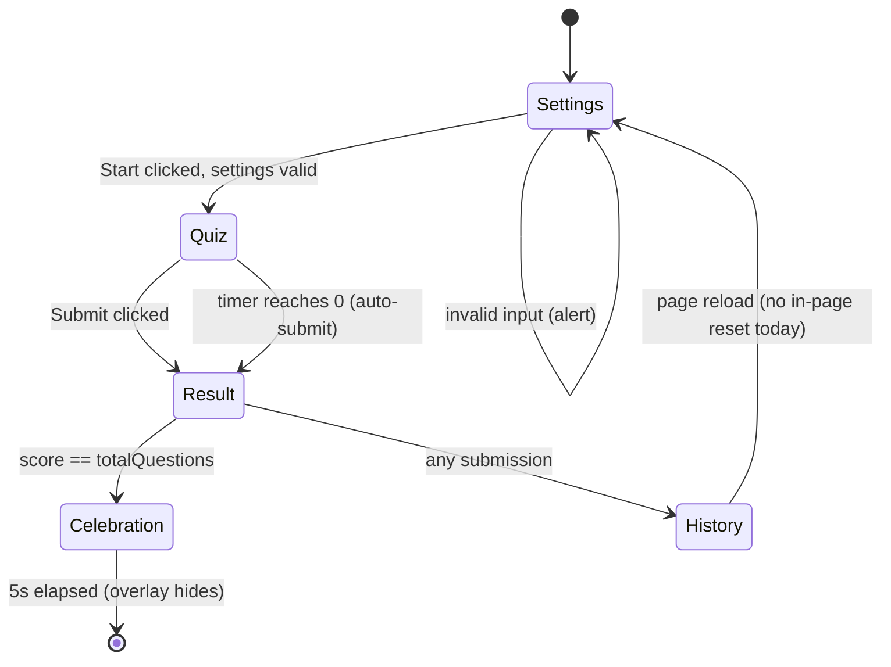
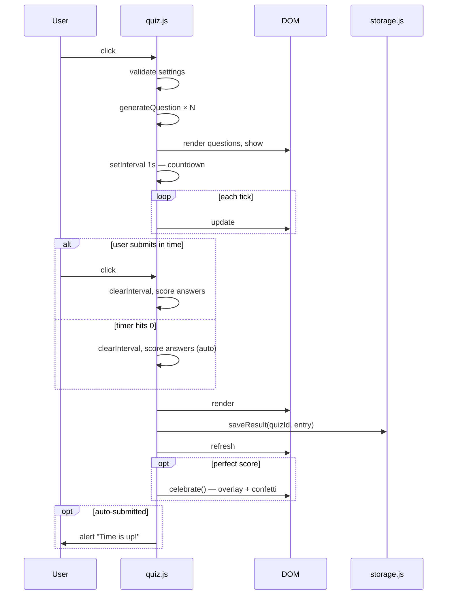

# Architecture

## Overview

`school` is a static, zero-build web app for kids to practice math drills. It is hosted on **GitHub Pages directly off `main`** — pushing to `main` is the deploy. There is no build pipeline, no test framework, no package manager, and no backend. All persistence is browser-local via `localStorage`.

The site is a small set of plain HTML pages that share a common quiz engine, styles, and storage layer through ES modules served as static files.

```
/
├── index.html                 # landing page
├── multiplication.html        # multiplication-table quiz
├── addition.html              # complement-of-addition quiz
├── assets/
│   ├── quiz.css               # shared styles (timer, celebration, confetti)
│   ├── quiz.js                # engine: orchestrates Settings → Quiz → Result → History
│   ├── storage.js             # versioned, namespaced localStorage layer
│   └── celebration.js         # confetti + congrats overlay (perfect-score reward)
├── ARCHITECTURE.md            # this file
├── README.md
└── CLAUDE.md
```

## Module responsibilities

| Module | Responsibility |
|---|---|
| `assets/quiz.js` | Wires the page DOM to the quiz lifecycle. Calls the page-supplied `generateQuestion` `totalQuestions` times, manages the countdown timer, scores, renders feedback, persists results, triggers the celebration on a perfect score. |
| `assets/storage.js` | The only module that touches `localStorage`. Versioned namespace `school.v1.*`, profile-aware from day one, runs a one-shot migration of legacy keys. |
| `assets/celebration.js` | Confetti shower + congrats overlay. Returns a Promise so future hooks (sounds, badges) can chain on it. |
| `assets/quiz.css` | Shared visual styles for the timer, celebration overlay, and confetti pieces. |
| `<topic>.html` | Standardised markup contract + a small `<script type="module">` that calls `startQuiz({ quizId, generateQuestion, validateSettings? })`. |

## DOM contract for a quiz page

Every quiz page must expose these IDs/sections — `assets/quiz.js` queries them by ID:

- `#settings`, `#quiz`, `#result`, `#history` — the four flow sections (visibility toggled with Bootstrap's `visually-hidden`)
- `#numQuestions`, `#timerDuration` — generic settings inputs
- `#startQuiz` — start button
- `#questions`, `#timer`, `#submit` — quiz section
- `#historyList` — `<ul>` for the latest 5 results
- `#celebration`, `#confetti` — overlay + confetti container (used by `celebration.js`)

Quiz-specific settings (e.g. `#complementNumber` in the addition quiz) are read directly inside the page's `generateQuestion` / `validateSettings` closures — the engine doesn't need to know about them.

## Quiz lifecycle



The Settings card hides when the quiz starts, the Quiz card hides when results render. The History card is always visible — it loads on page open and refreshes after each submission.

## Timer / auto-submit sequence



## Storage schema

All keys live under the `school.v1.*` namespace. History is keyed by `profileId + quizId` from day one (default `profileId = "default"`) so per-child profiles can ship later **with no migration**.

| Key pattern | Type | Notes |
|---|---|---|
| `school.v1.activeProfileId` | string | Defaults to `"default"` if absent. |
| `school.v1.profiles` | `[{ id, name, avatar }]` | Future — profile picker on `index.html`. |
| `school.v1.history.<profileId>.<quizId>` | `[{ score, totalQuestions, timerDuration, timeLeft, submittedAutomatically, date }]` | Capped at 5 entries, newest first. |
| `school.v1.level.<profileId>.<quizId>` | number | Future — difficulty progression. |
| `school.v1.achievements.<profileId>` | `[{ id, unlockedAt }]` | Future — badges. |
| `school.v1.theme` | string | Future — themes. |

`migrateLegacyHistory()` runs once on engine init and copies any pre-namespaced `multiplicationHistory` / `additionHistory` arrays into `school.v1.history.default.<quizId>`, then removes the old keys. Idempotent.

## Future-feature seams

Each item on the wishlist has a known place to land **without touching the engine**:

| Feature | Where it slots in |
|---|---|
| New quiz type | New `<topic>.html` (copy from `multiplication.html`) + `generateQuestion` closure. No engine edit. |
| Per-child profiles | Profile picker on `index.html` writes `school.v1.activeProfileId`; storage already keys by it. |
| Difficulty progression | `generateQuestion` already receives `{ level }`, but the engine currently hardcodes `level: 1`. Wiring real difficulty means adding `loadLevel(quizId)` / `saveLevel(quizId, n)` to `storage.js` and reading them in the engine — a small engine touch, not a no-engine-edit case. |
| Themes | Structurally compatible (toggle a `data-theme` on `<html>`, ship `assets/themes/<name>.css`), but `quiz.css` doesn't yet use CSS custom properties or `[data-theme=…]` selectors. The first real theme will introduce the variable layer. |
| Sounds | `celebration.js` exposes a Promise return; sounds can be added there or via a sibling `assets/audio.js`. |
| Badges | New `assets/achievements.js`; engine emits events the achievements module subscribes to. |

## Adding a new quiz

1. Copy `multiplication.html` to `<topic>.html`.
2. Update `<title>` and `<h1>`.
3. Inside the `<script type="module">`, change the `quizId` and replace `generateQuestion` with the new math.
4. If the quiz needs extra settings inputs (like addition's complement number), add them to the `#settings` card and read them inside the `generateQuestion` / `validateSettings` closures.
5. Add a `<li><a>` to `index.html`.

Pick a unique `quizId` — it becomes part of the localStorage key (`school.v1.history.<profileId>.<quizId>`).

## Local development

There is no build. Open the HTML files directly in a browser, or serve the directory:

```
python3 -m http.server 8000
# http://localhost:8000/
```

`<script type="module">` requires a real origin in some browsers (file:// can be flaky) — prefer the local server when iterating.

## Conventions

- Bootstrap 5.3 from CDN with SRI hashes pinned. Don't drop the integrity hashes when changing the version.
- Use Bootstrap utility classes for layout. Custom CSS only for things Bootstrap doesn't provide (animations, the timer typography).
- Don't introduce a build step, framework, or package manager without a concrete reason.
- localStorage writes go through `assets/storage.js`. Pages must not call `localStorage.getItem/setItem` directly.
