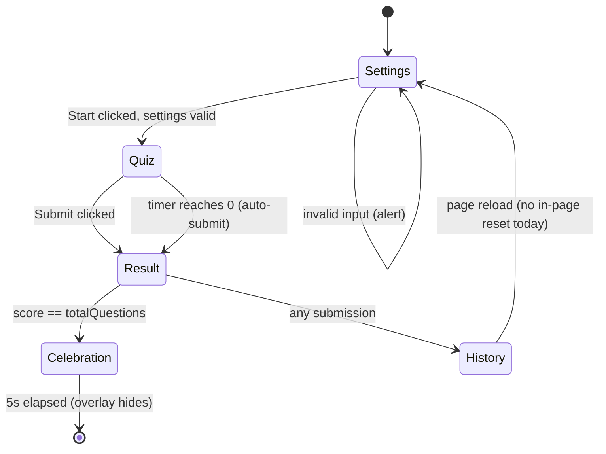
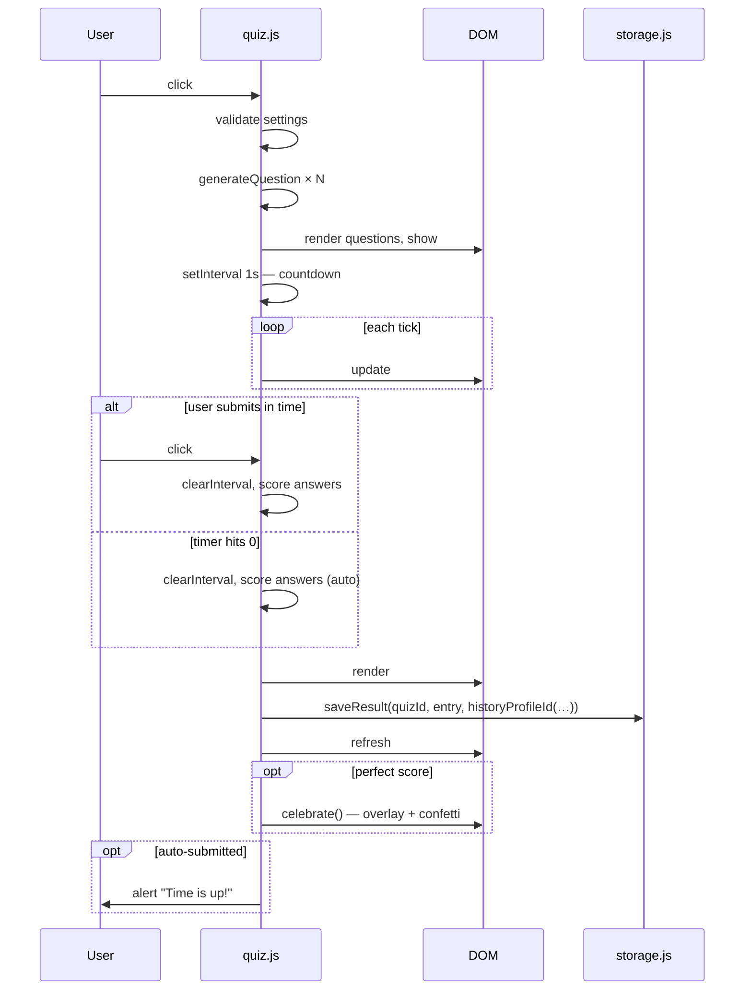
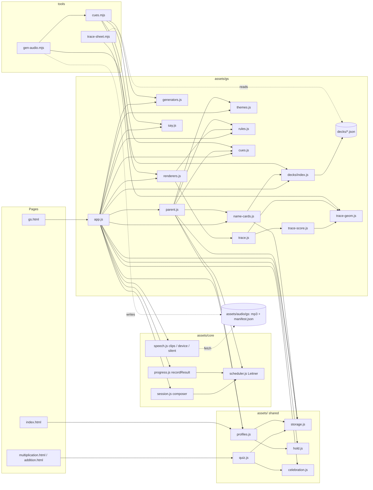
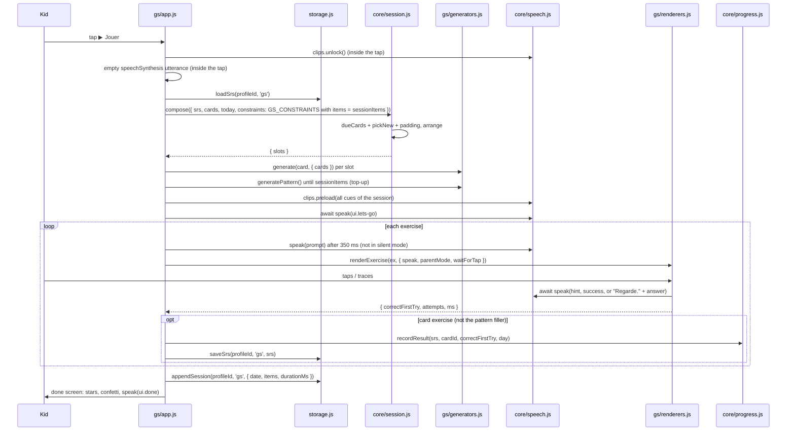
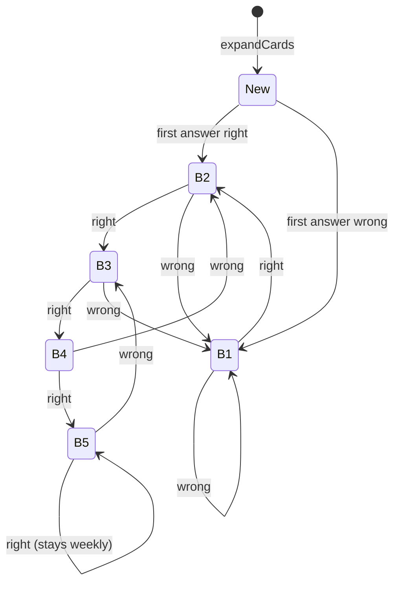
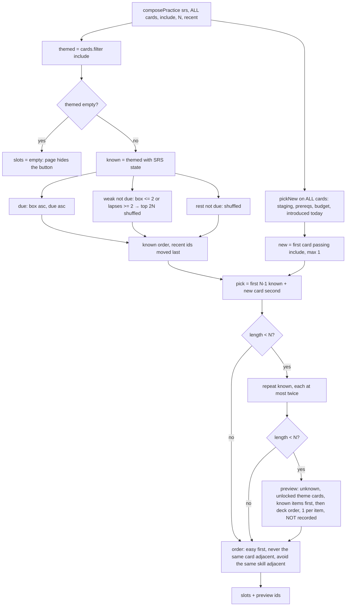
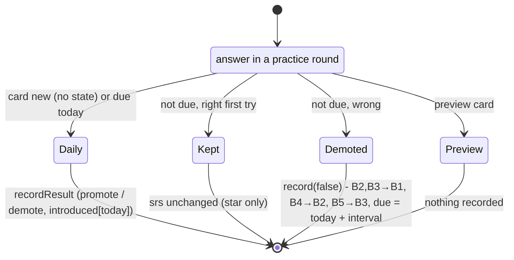
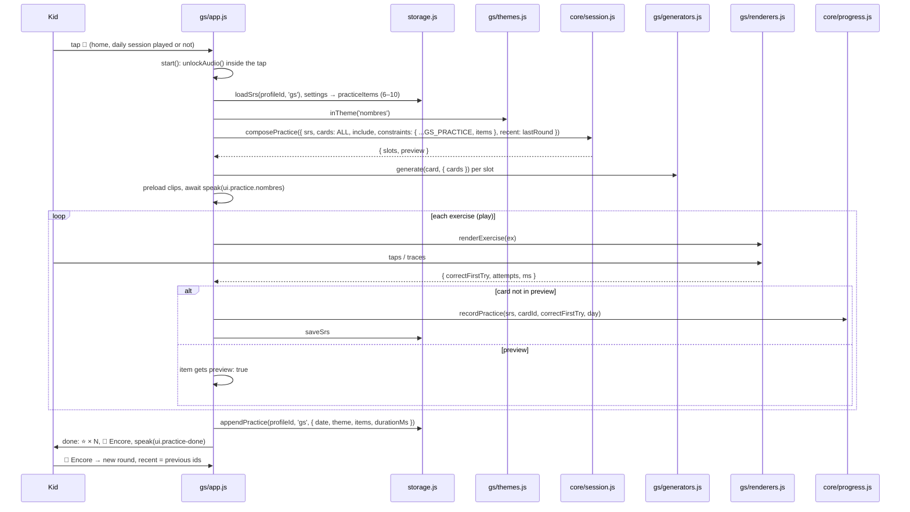
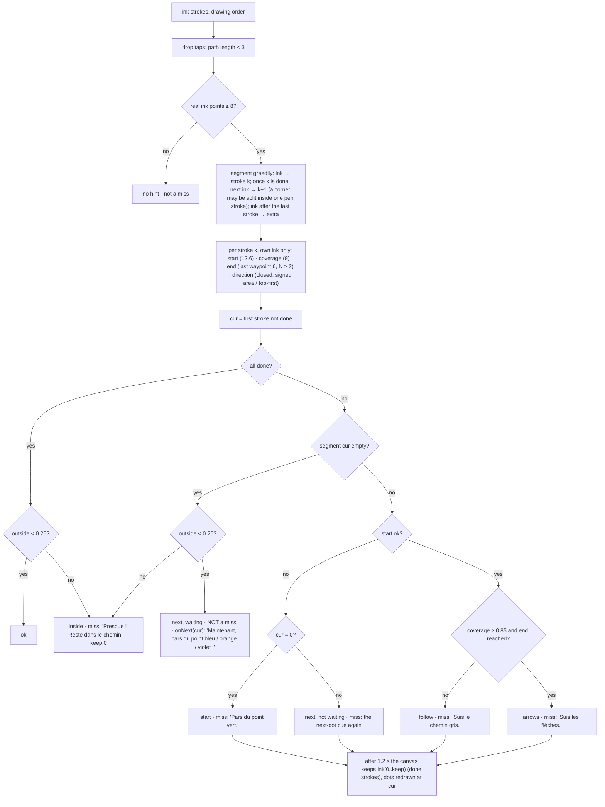
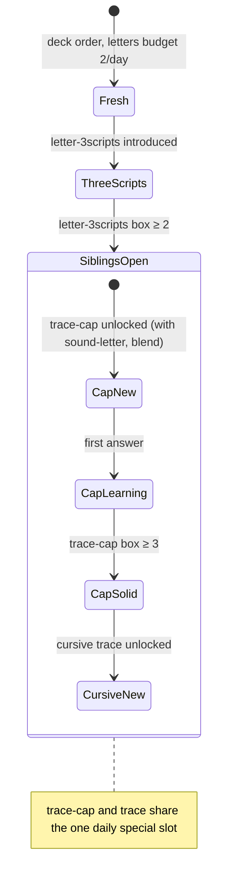

# Architecture

## Overview

`school` is a static, zero-build web app for the owner's kids: timed math quizzes for the older child, and a spaced-repetition **learning track** for the younger one (Grande Section de maternelle: sounds, letters, syllables, tracing in capitals and cursive, numbers to 10), with one daily session plus unlimited themed practice rounds. It is hosted on **GitHub Pages directly off `main`** — pushing to `main` is the deploy. There is no build pipeline, no package manager, no CI and no backend. All persistence is browser-local via `localStorage`. Pure modules are covered by `node --test` (Node's built-in runner, no dependencies); DOM code is hand-tested.

The site is a small set of plain HTML pages sharing ES modules served as static files.

```
/
├── index.html                 # landing page: "Qui joue ?" profile picker + "Autres jeux" (math quizzes)
├── multiplication.html        # multiplication-table quiz
├── addition.html              # complement-of-addition quiz
├── gs.html                    # Grande Section learning track (one page, four screens)
├── assets/
│   ├── quiz.css, quiz.js      # math quiz styles + engine (Settings → Quiz → Result → History)
│   ├── storage.js             # versioned, namespaced localStorage layer (the only localStorage user)
│   ├── celebration.js         # confetti + congrats overlay
│   ├── profiles.js            # profile picker, profile ↔ track resolution, first-name sync
│   ├── hold.js                # long-press parental gate
│   ├── core/                  # track-agnostic learning engine (pure except speech.js)
│   │   ├── scheduler.js       # Leitner boxes
│   │   ├── session.js         # daily session composer + practice round composer
│   │   ├── progress.js        # one answered card → next SRS state (daily and practice rules)
│   │   └── speech.js          # audio sources: clips / device voice / silent
│   ├── gs/                    # Grande Section track
│   │   ├── app.js             # page controller (home → daily session or practice round → done, parent corner)
│   │   ├── parent.js          # parent corner
│   │   ├── themes.js          # practice themes (Sons, Lettres, Écrire, Nombres): skill → theme
│   │   ├── generators.js      # card → exercise (pure)
│   │   ├── renderers.js       # exercise → DOM, resolves with the result
│   │   ├── trace.js           # tracing canvas (Pointer Events, Pencil, numbered start dots)
│   │   ├── trace-score.js     # pure N-stroke corridor scorer + pointer filter
│   │   ├── trace-geom.js      # pure tracing geometry: lignage, curves, arrows, start dots (canvas + trace-sheet)
│   │   ├── rules.js           # pure page rules (local day, daily cap, practice size, parent mode, labels)
│   │   ├── cues.js            # fixed cues spoken by app.js / parent.js
│   │   ├── say.js             # text sent to a TTS engine (stretched sounds)
│   │   ├── name-cards.js      # drops the old first name's card progress
│   │   ├── gs.css
│   │   └── decks/             # index.js (DECK_FILES, expandCards) + letters.json, numbers.json,
│   │                          #   mots-p1.json (période 1), mots-gs.json (generic GS words)
│   └── audio/gs/              # pre-recorded mp3 clips + manifest.json + sources.json
├── tools/                     # gen-audio.mjs (clip recorder), cues.mjs (cue enumeration),
│                              #   trace-sheet.mjs (trace model renderer), README.md
├── tests/                     # *.test.mjs (node:test) + helpers/fake-storage.mjs
├── ARCHITECTURE.md            # this file
├── README.md
└── CLAUDE.md
```

## Math quizzes

### Module responsibilities

| Module | Responsibility |
|---|---|
| `assets/quiz.js` | Wires the page DOM to the quiz lifecycle. Calls the page-supplied `generateQuestion` `totalQuestions` times, manages the countdown timer, scores, renders feedback, persists results, triggers the celebration on a perfect score. History goes to the profile chosen by `historyProfileId` (see the storage schema). |
| `assets/storage.js` | The only module that touches `localStorage`. Versioned namespace `school.v1.*`, profile-aware, runs a one-shot migration of legacy keys. |
| `assets/celebration.js` | Confetti shower + congrats overlay. Returns a Promise. Also used by the GS done screen. |
| `assets/quiz.css` | Shared visual styles for the timer, celebration overlay, and confetti pieces (also loaded by `gs.html`). |
| `<topic>.html` | Standardised markup contract + a small `<script type="module">` that calls `startQuiz({ quizId, generateQuestion, validateSettings? })`. |

### DOM contract for a quiz page

Every quiz page must expose these IDs/sections — `assets/quiz.js` queries them by ID:

- `#settings`, `#quiz`, `#result`, `#history` — the four flow sections (visibility toggled with Bootstrap's `visually-hidden`)
- `#numQuestions`, `#timerDuration` — generic settings inputs
- `#startQuiz` — start button
- `#questions`, `#timer`, `#submit` — quiz section
- `#historyList` — `<ul>` for the latest 5 results
- `#celebration`, `#confetti` — overlay + confetti container (used by `celebration.js`)

Quiz-specific settings (e.g. `#complementNumber` in the addition quiz) are read directly inside the page's `generateQuestion` / `validateSettings` closures — the engine doesn't need to know about them.

### Quiz lifecycle



The Settings card hides when the quiz starts, the Quiz card hides when results render. The History card is always visible — it loads on page open and refreshes after each submission.

### Timer / auto-submit sequence



### Adding a new quiz

1. Copy `multiplication.html` to `<topic>.html`.
2. Update `<title>` and `<h1>`.
3. Inside the `<script type="module">`, change the `quizId` and replace `generateQuestion` with the new math.
4. If the quiz needs extra settings inputs (like addition's complement number), add them to the `#settings` card and read them inside the `generateQuestion` / `validateSettings` closures.
5. Add a `<li><a>` to the "Autres jeux" list in `index.html`.

Pick a unique `quizId` — it becomes part of the localStorage key (`school.v1.history.<profileId>.<quizId>`).

## Storage schema

All keys live under the `school.v1.*` namespace and are read/written only through `assets/storage.js`.

| Key pattern | Type | Notes |
|---|---|---|
| `school.v1.profiles` | `[{ id, name, avatar, track: 'gs' \| 'en', placeholder? }]` | Seeded on first visit by `profiles.js` with the children's real names: `kid-gs` "Apolline" (🦊, `gs`) and `default` "Louis" (🐼, `en`), no `placeholder` flag. `ensureProfiles()` upgrades a profile stored by an earlier version that still has `placeholder: true` **and** its legacy seeded name ("Enfant 1" / "Enfant 2") to the real name and drops the flag; a profile a parent renamed is left alone. On first open, `gs.html` prefills the GS `firstName` from the profile name (`prefillFirstName`). The 6ème child keeps the id `default` so the math history already under `history.default.*` stays his. |
| `school.v1.activeProfileId` | string | Defaults to `"default"` if absent. Written by the picker, and by `gs.html` when it has to fall back to a GS profile. |
| `school.v1.history.<profileId>.<quizId>` | `[{ score, totalQuestions, timerDuration, timeLeft, submittedAutomatically, date }]` | Math quizzes. Capped at 5 entries, newest first. Profile = `historyProfileId(profiles, activeId)`: the active profile only when its track is `'en'` (or no profiles exist yet), otherwise `'default'` — a math page opened after picking 🦊 keeps writing the older child's history. |
| `school.v1.settings.<profileId>` | `{ sessionItems, practiceItems, parentMode, firstName, audio, voice, extraSessionOn? }` | Defaults `{ sessionItems: 6, practiceItems: 6, parentMode: null, firstName: '', audio: 'clips', voice: '' }`, merged on read. `practiceItems`: games per practice round, read through `practiceItems(settings)` (`gs/rules.js`), which rounds and clamps it to 6–10. `parentMode: null` = never set by a parent (automatic, see Child UX rules); `true`/`false` = explicit. `audio`: `'clips' \| 'device' \| 'silent'`. `voice`: preferred device voice name. `extraSessionOn`: local day (`YYYY-MM-DD`) on which a parent allowed one more session. `firstName` feeds the greeting and the name-spell card. |
| `school.v1.srs.<profileId>.<trackId>` | `{ cards: { [cardId]: { box, due, seen, lapses } }, introduced: { [day]: [itemKey] } }` | Leitner state. `cardId = <deckId>/<itemId>#<skill>` (e.g. `letters/a#trace-cap`, `letters/a#trace`, `mots-gs/robot#sound-final`, `numbers/7#trace`, `name/lea#name-spell`); `itemKey = <deckId>/<itemId>`. `due` and the `introduced` keys are local days. One state for both the daily session and practice rounds; `introduced` is the shared daily new-item budget. |
| `school.v1.sessions.<profileId>.<trackId>` | `[{ date, items: [{ cardId, type, correctFirstTry, attempts, ms }], durationMs }]` | **Daily sessions only.** Last 14 completed sessions, newest first. `date` is an ISO timestamp; the pattern filler game stores `cardId: null`. Drives the daily cap and the parent corner's daily week line. |
| `school.v1.practice.<profileId>.<trackId>` | `[{ date, theme, items: [{ cardId, type, correctFirstTry, attempts, ms, preview? }], durationMs }]` | Completed practice rounds, newest first, capped at 30 (`appendPractice`). `theme` is a `THEMES` id; `preview: true` marks an item played for exposure and never recorded in the SRS. A round left with 🏠 is not appended (its answered cards are already in the SRS). Feeds the parent corner's practice line. **Separate on purpose:** `sessions` holds 14 entries and drives `dailyCapReached`; unlimited practice rounds stored there would evict today's daily session and give ▶ Jouer back. With two keys, practice can never touch the daily cap. |
| `school.v1.level.<profileId>.<quizId>` | number | Future — math difficulty progression. |
| `school.v1.achievements.<profileId>` | `[{ id, unlockedAt }]` | Future — badges. |
| `school.v1.theme` | string | Future — themes. |

`trackId` is `'gs'` today; the 6ème track will use `'en'` with the same keys. `migrateLegacyHistory()` runs once on quiz-engine init and copies any pre-namespaced `multiplicationHistory` / `additionHistory` arrays into `school.v1.history.default.<quizId>`, then removes the old keys. Idempotent.

## Learning tracks

A track = a set of decks, generators and renderers on top of a shared, track-agnostic engine. Grande Section (`gs.html`) is the only track shipped; the 6ème track (`'en'`) currently has only a profile and the math quizzes.

### Modules

| Layer | Module | Responsibility |
|---|---|---|
| core | `assets/core/scheduler.js` | Pure Leitner: `record`, `dueCards`, `boxCounts`, `addDays`; `GS_PROFILE` intervals. |
| core | `assets/core/session.js` | Pure daily `compose({ srs, cards, today, rng, constraints })` → `{ slots, introduced }` with `GS_CONSTRAINTS`; pure `composePractice({ srs, cards, today, include, rng, constraints, recent })` → `{ slots, preview }` with `GS_PRACTICE` (see Practice rounds). Both share `pickNew` (staging, prerequisites, budget). |
| core | `assets/core/progress.js` | Pure `recordResult(srs, cardId, correctFirstTry, today)`: `record` + daily-introduction bookkeeping. Pure `recordPractice(…)` (same arguments): the practice Leitner rule. |
| core | `assets/core/speech.js` | `createSpeech` (one `speak(cue) → Promise` over ordered sources), `createClipSource`, `createDeviceSource`, `SILENT_SOURCE`, `rankVoice`. |
| shared | `assets/storage.js` | All persistence (see schema), including `loadPractice` / `appendPractice`. |
| shared | `assets/profiles.js` | `ensureProfiles` (seeds Apolline / Louis, upgrades legacy placeholders), `selectProfile` (track → page: `gs` → `gs.html`; others stay on the landing page and open "Autres jeux"), `trackProfileId`, `renameProfile` / `setFirstName` (one name per child), `prefillFirstName`, `mountProfiles`. |
| shared | `assets/hold.js` | `holdToActivate(el, action, ms = 1500)`: long-press gate, plain taps do nothing. |
| shared | `assets/celebration.js` | Confetti on the done screen. |
| gs | `assets/gs/app.js` | Page controller: profile resolution, audio wiring, home (▶ Jouer + the four theme buttons built from `THEMES`) / exercise / done screens, daily cap, quit button, gates. `runSession` (daily) and `runPractice(themeId)` both play through `play(exercises, onAnswered, { badge })`; `start(run)` is the one entry for ▶ Jouer, a theme button and 🔁 Encore (a second tap while a round starts is ignored, audio is unlocked in the tap, a crash goes back home); `showDone(items, { again })` is the daily or practice done screen. `lastRound` (in memory) feeds `recent`. |
| gs | `assets/gs/parent.js` | Parent corner ("Coin des parents"): first name, items per session (5–8), games per practice round (6–10), parent mode, audio source + voice + "🔊 Tester", today's cap and extra session, Leitner boxes, decks, week summary (daily line + practice line) and "À surveiller" (≥ 2 lapses). |
| gs | `assets/gs/themes.js` | Pure `THEMES` (`{ id, emoji, label, skills }` × 4), `themeOf(card)`, `inTheme(id)` → predicate. Themes are a GS concept: core only receives `inTheme(id)` as `include`. |
| gs | `assets/gs/decks/index.js` | `DECK_FILES` (`letters`, `numbers`, `mots-p1`, `mots-gs`), `loadDecks`, `expandCards(decks, { firstName })` (item × skill → cards), `nameItemId`. |
| gs | `assets/gs/generators.js` | Pure `generate(card, { cards, rng })` → exercise `{ type, layout, prompt, stage, choices, success, reveal?, trace?, … }`; `generatePattern(rng)`; `phoneme`; `heard` (what an oral syllable sounds like, so no two tiles sound alike); `OBJECTS` (counted objects with gender); `PATTERN_NAMES`. Distractor traps (close phonemes, confusable letters, 6/9 and 1/7, initial vs final sound, the word's own other syllable). |
| gs | `assets/gs/renderers.js` | `renderExercise(root, ex, { speak, parentMode, waitForTap, onSettle })` → `{ correctFirstTry, attempts, ms }`; layouts `tap`, `multitap`, `select`, `dots`, `slots`, `trace`; stages include dice (CSS pips) and two added groups; `UI_CUES` (incl. `traceHint.*` and `traceNext[1–3]`). |
| gs | `assets/gs/trace.js` | `mountTrace(container, model, { onResult, onNext })`: model + ink canvases, Pointer Events, Pencil pressure, lift grace, numbered start dots redrawn after every lift, partial clear after a miss. |
| gs | `assets/gs/trace-score.js` | Pure N-stroke corridor `score`, `keepStrokes`, `createPointerFilter`, `TRACE_HINTS`, `NEXT_HINTS`. |
| gs | `assets/gs/trace-geom.js` | Pure geometry shared by `trace.js` and `tools/trace-sheet.mjs`: `LIGNAGE`, `lignageFor('cursive' \| 'cap')`, `strokesOf(model)`, `MAX_STROKES` (4), `DOT_COLORS`, `startDots(strokes, cur)`, `curveSegments`, `arrowSpots`. |
| gs | `assets/gs/rules.js` | Pure: `localDay`, `dailyCapReached`, `extraSessionState`, `effectiveParentMode`, `practiceItems`, `cardLabel`, `adultHint`. |
| gs | `assets/gs/cues.js`, `say.js`, `name-cards.js` | Page cues (`PAGE_CUES`, incl. `practice.<theme>` and `practiceDone`); `sayInput` (TTS input for stretched sounds); `pruneNameCards`. |
| page | `gs.html`, `index.html` | Thin shells: markup + one module (`assets/gs/app.js`, inline `mountProfiles`). `gs.html` holds `#themes` (the theme buttons) and `#again` (🔁 Encore) on the done screen. |
| tools | `tools/cues.mjs`, `tools/gen-audio.mjs` | Enumerate every cue from the generators and cue tables; record one clip per key (see `tools/README.md`). |
| tools | `tools/trace-sheet.mjs` | Dev aid: renders trace models to SVG through `trace-geom.js` (exactly what the canvas draws) for the render-and-look check (see `tools/README.md`). |

**Dependency rule:** `assets/core/*` imports only other core modules — never `storage.js`, a track, or the DOM (except `speech.js`, which uses `Audio`/`speechSynthesis`). Tracks import core; core receives everything track-specific as arguments. What remains coupled:

- GS defaults live in core as named exports used as default arguments: `GS_PROFILE` (`scheduler.js`, `progress.js`), `GS_CONSTRAINTS` and `GS_PRACTICE` (`session.js`), the French voice preference list and `lang = 'fr'` (`speech.js`). Skill names reach core only as **data** in those constraints (`specialSlotSkills`, `prereqs`); core never tests a skill name in code. The 6ème track must pass its own.
- Practice themes stay in the track: the page passes `inTheme(id)` to `composePractice` as `include(card) → boolean`.
- `storage.js` `DEFAULT_SETTINGS` (6 items, `audio: 'clips'`) is GS-flavoured but per profile.
- `profiles.js` knows the track → page map (`TARGET`) and the track labels.



### Session flow



The profile id is captured at session start; every write is best-effort (`persist`: a full or blocked storage logs and the game goes on). An item counts as introduced only when one of its cards is answered, so an abandoned session does not burn the daily budget.

### Card lifecycle (Leitner, `GS_PROFILE`)

Intervals by box: B1 = 1 day, B2 = 2, B3 = 4, B4 = 7, B5 = 7. A card has no state until its first answer, which is recorded from box 1. "Right" means right on the first try; any miss in the exercise counts as wrong (the child still finishes the item).



### Composer rules (`compose` + `GS_CONSTRAINTS`)

- **Candidates, in priority order:** due cards (`due <= today`, lowest box first, then oldest due) → new cards → due cards left over → padding.
- **New cards** (`pickNew`, shared with practice rounds): item budget per day and kind (`newPerDay`: letters 2, words 3, numbers 1, name 1) minus the items already in `introduced[today]` (daily session and practice rounds share it); decks are introduced in deck order. A brand-new item enters with its **first skill only** (staged siblings); its other skills become new cards once that first card reached box ≥ 2, and never charge the budget again.
- **Prerequisites** (`prereqs`, GS: `[{ skill: 'trace', after: 'trace-cap', box: 3 }]`): a card of `skill` stays locked while its item has a sibling of skill `after` below `box` (unseen counts as box 0). **Capitals first:** a letter's cursive `trace` is not introduced before its `trace-cap` reached box 3. An item with no such sibling is never locked (digits have no `trace-cap`, so their `trace` is not gated). Gates apply to unseen cards only: a `trace` card already in the SRS stays scheduled.
- **Special skills** (`specialSlotSkills`, GS: `['trace-cap', 'trace']`; a legacy `specialSlotSkill` string is still accepted): while no special card is known, the first fresh item that has an unlocked special card also brings it (trace co-introduction: for a fresh letter that is its `trace-cap`, never the cursive `trace`). Fresh items and unlocked skills are interleaved.
- **Reserved new slots:** up to 2 slots are kept for new cards whenever some exist; due reviews beyond that (the highest boxes) slip to a later day, still ahead of padding.
- **Arrangement** (fills left to right, stops at the first slot it cannot fill — never compacts across a gap):
  - at most **one** special card per session (a `trace-cap` or a `trace`, letter or digit), only at slot index 2 or 3 (one picked at random; index 3 is a fallback only when 2 was the pick and nothing fit);
  - at most 2 `numbers` cards (`limitedKind`); a digit `trace` card is `kind: 'numbers'`, so it counts here too and competes with letter traces for the one special slot;
  - never the same skill in two adjacent slots;
  - soft: at most 2 cards of one skill while another candidate fits (a new card in a reserved slot wins over variety);
  - soft: one easy card (box ≥ 3) in slot 0 or 1 when one exists.
- **Padding:** review cards not yet due, highest box first (shuffled within a box) — box ≥ 4 first, lower boxes only when those run out; never new cards.
- **Pattern top-up:** `app.js` appends `generatePattern()` exercises until the session has `sessionItems` items; they are not cards and are not recorded in the SRS.

**Card expansion** (`expandCards`, deck skill order = staging order; new skills are appended so every card id shipped before stays the same — pinned by `tests/helpers/card-ids-2026-10-17.json`):

| Kind | Skills |
|---|---|
| letters | `letter-3scripts` (first), `sound-letter` (needs `sound`), `trace-cap` (needs `capTrace`), `trace` (needs `trace`), `blend` (a continuant with a `sound`) |
| words | first skill rotating by deck index (`syll-count`, `sound-pick`, then `syll-match` / `rhyme` when the word has them), the others, then `sound-final` (when `final` is not `null`) and `syll-initial` (≥ 2 oral syllables). `syll-match` / `rhyme` exist only when another word of the **same deck** shares the first oral syllable / the rhyme. |
| numbers | `count`, `compare` (n ≥ 1), `decompose` (n ≥ 2), `number-line`, `dice`, `before-after` (n ≥ 1), `add` (2–5), `trace` (digits 0–9; 10 has none). 0 has only `trace` and is last in `numbers.json`, so it is introduced after 10. |
| name | one `name-spell` card for the first name |

### Practice rounds (`composePractice` + `GS_PRACTICE`, `recordPractice`)

Under ▶ Jouer, home shows four theme buttons (`THEMES`): 👂 Sons, 🔤 Lettres, ✏️ Écrire, 🔢 Nombres. Each starts a **practice round** of `practiceItems(settings)` games (6–10, default 6) of that theme only. Rounds are unlimited and never count toward the daily cap. A card belongs to exactly one theme, by its skill (`themeOf`); a digit `trace` is Écrire, never Nombres.

| Theme | Skills |
|---|---|
| `sons` 👂 | `syll-count`, `syll-match`, `syll-initial`, `rhyme`, `sound-pick`, `sound-final`, `blend` |
| `lettres` 🔤 | `letter-3scripts`, `sound-letter`, `name-spell` |
| `ecrire` ✏️ | `trace-cap`, `trace` |
| `nombres` 🔢 | `count`, `compare`, `decompose`, `number-line`, `dice`, `before-after`, `add` |

Sons uses 👂, not 🔊: 🔊 is the exercise's replay button.

**Composer** (`GS_PRACTICE = { items: 6, maxNew: 1, maxRepeat: 2, weakBox: 2, weakLapses: 2, newPerDay, specialSlotSkills, prereqs }`, the last three taken from `GS_CONSTRAINTS`). `include(card)` is the only theme knowledge. `cards` is **all** cards, not the theme's: new-card eligibility (staging, prerequisites, the per-kind budget, `introduced[today]`) must see the full set, otherwise a letter whose `letter-3scripts` is known would look fresh in an Écrire round and charge the budget again.

1. Known = theme cards with an SRS state. **Due** (box ascending, then due ascending) → **weak** not-due cards (box ≤ 2 or lapses ≥ 2; sorted box ascending, lapses descending, due ascending; the first 2 × N shuffled) → **rest** (shuffled). Ids in `recent` (the previous round of this theme, kept in memory by `app.js`) go to the end, so 🔁 Encore plays something else first.
2. **New:** `pickNew` on all cards, filtered by `include`, at most 1, inside the shared daily budget. An unlocked sibling counts as the round's new card.
3. **Pick** the first N − new known cards, plus the new card placed second (early, never first).
4. **Repeats** while short: known cards again, each at most twice per round.
5. **Previews** while still short: theme cards with no SRS state, never a locked card (no cursive `trace` before its capital), items she already knows first, then deck order, one per item. They are played and starred but **never recorded** (no Leitner state, no budget charge) and returned in `preview`.
6. **Order:** slot 0 = the first card with box ≥ 3, else the first known card, else the first card; then each slot takes the first card whose id **and** skill differ from the previous one, else the first whose id differs; it stops rather than show the same card twice in a row. The daily arrangement rules (special slot, ≤ 2 numbers, ≤ 2 per skill, reserved slots, pattern top-up) do not apply.
7. Empty theme → `{ slots: [], preview: [] }` and the page hides that button.



**Leitner in practice** (`recordPractice`): a new or due card records exactly as in the daily session (`recordResult`, which also charges `introduced[today]` for a brand-new item); a card that is not due yet keeps its state when answered right (a star, no promotion: the schedule decides when it comes back) and is demoted when wrong. Repeats inside a round go through the same rule with the live `srs`. A due card answered in practice leaves that day's daily queue; the daily composer pads as usual.



**Round flow.** A theme tap goes through `start(run)` like ▶ Jouer (audio unlocked inside the tap, a second tap ignored). The exercise screen is the daily one (autoplay, 🔊, 🏠, parent and silent modes, two-miss rule) with the theme emoji in the counter ("🔢 3 / 8") and no pattern filler. The done screen says "Bravo Apolline !", shows one ⭐ per game, hides "À demain" and shows **🔁 Encore** (`#again`, same theme, yellow so a non-reader tells it from the green 🏠). 🏠 mid-round keeps what was answered in the SRS and does not append the round.



**Parent corner:** "Nombre de jeux par entraînement (👂 🔤 ✏️ 🔢)" (6–10) and, under the daily week line, the practice line from the practice log, e.g. "Entraînements : 8 parties (👂 1 · 🔤 1 · ✏️ 1 · 🔢 5) · 29 % du premier coup" (themes in `THEMES` order, a theme with no round omitted, preview items excluded from the %), or "Aucun entraînement cette semaine.".

### Tracing

**Model data.** All coordinates live in a 100 × 100 box.

| Deck field | Meaning | Scored |
|---|---|---|
| `letters[].trace`, `numbers[].trace` | cursive letter / maternelle digit, one polyline of `[x, y]` waypoints | yes |
| `trace2` (x, 4, 5) | second stroke | yes |
| `letters[].capTrace` | capital (capitale d'imprimerie): always an **array of strokes**, 1–4 (61 strokes for the 26 letters) | yes |
| `bar` (t, 7), `dot` (i, j) | finishing bar, dot | no (drawn only) |
| `dirOrder: 'top-first'` (8) | the 8's direction is judged by order of reach (its lobes cancel in a signed area) | — |

The generator builds one runtime shape for every trace exercise: `ex.trace = { strokes, dot?, bar?, dirOrder?, lignage: 'cursive' | 'cap', label, say, kind: 'letter' | 'digit' | 'cap' }` (`strokes = [trace, trace2]` for cursive letters and digits, `capTrace` for capitals). `strokesOf(model)` (`trace-geom.js`) normalises it, and also accepts the legacy `{ pts, pts2 }` shape the tests use. `MAX_STROKES = 4` (E, M, W).

**Lignage** (`lignageFor`): cursive letters and digits get a tinted x-height band 42–72, faint lines at 16 (ascender) and 92 (descender), a light x-height line and a strong baseline at 72; the hampe line 30 (tops of t, d and digits) is a guide for the models, never drawn. Capitals span 16 → 72 with **no band**: a cap line at 16, a faint bar guide at 44 and the baseline at 72.

**Model conventions** (tested where possible in `tests/trace-models.test.mjs`):

- Cursive letters (French school cursive): x ~18–88; an entry ligature from the baseline on the left, except the round family a c d g o q, which starts on the round (right side, just under the x-height) going counter-clockwise; an exit ligature, high at x-height level for b o v w; upward loops opening left for b f h k l (top on 16); descender loops for f g j y z, straight stems to 92 for p q.
- Digits: maternelle formation, no ligatures, body x 34–66, top 30, baseline 72.
- Capitals: one straight line or one curve per stroke ("lift at every corner"); vertical and oblique lines top → bottom, horizontal lines left → right, round letters (C G O Q S) start at the top and turn counter-clockwise; order: highest start first, then leftmost, bars after the lines they join; top on 16, bottom on 72 (Q's tail to 78); ≥ 4 waypoints per stroke, ≤ 12 apart, straight strokes evenly spaced.
- An open stroke ends ≥ 15 from its start, so a reversed stroke fails its start check. A **closed** stroke (first and last waypoints < 12.6 apart: 0, 8, O, Q's ring) is judged by turning direction instead.

**Start dots** (`startDots(strokes, cur)`, `DOT_COLORS` green, blue, orange, violet by stroke index): done strokes lose their dot, the next stroke (`cur`) has a filled dot, later ones a ring; digits 1–4 are drawn inside the dots only on models with ≥ 2 strokes (one-stroke models keep a plain green dot); a later dot within 7 of a dot already shown is hidden until its turn (A, B, D, E, F, M, N, P, R, W, where two strokes leave the same point). `trace.js` redraws the dots after every lift.

**Scoring** (`score(ink, model)` → `{ ok, coverage, outside, startOk, hint, hintKey, next, waiting, keep }`): taps (path length < 3) are dropped; with fewer than 8 real ink points there is no hint and no miss. Real ink strokes are assigned greedily in drawing order: each goes to the expected stroke k until k is done, then to k + 1 (an unfinished stroke keeps receiving ink, so a mid-stroke lift continues it); ink after the last stroke only counts toward `outside`. Each stroke is judged on its own ink: start within 12.6 of its dot (and no nearer a later dot), coverage ≥ 0.85 of its waypoints within 9, on multi-stroke models its last waypoint reached within 6, and for a closed stroke the sign of the ink's signed area (the 8: order of reach, `topFirst`). **Corners (Q12):** where stroke k ends on stroke k + 1's start (B, K, L, R, Y, Z), one pen stroke may run on into k + 1; it is split at the corner once k is done.



**Canvas** (`mountTrace(container, model, { onResult, onNext })`): a lift waits `LIFT_GRACE_MS` (900 ms), or `MULTI_STROKE_GRACE_MS` (2500 ms) on models with ≥ 2 strokes, before it is scored, so the next stroke or a mid-letter lift continues the same attempt. `onNext(k)` fires once per stroke k per attempt when the result first waits at dot k, and once more after `NEXT_IDLE_MS` (8 s) without ink; the renderer says `UI_CUES.traceNext[k]` (`ui.trace-blue`, `ui.trace-orange`, `ui.trace-violet`). After a miss the ink clears after 1.2 s but keeps the strokes already done (`keep`), so the child goes on from the next dot; an `inside` miss clears everything; ↺ always clears everything. A waiting result is not a miss.

**Known limits.** The order of two strokes that leave the same dot is not enforced as such: drawn the other way round, both inks count toward the first stroke and the child is sent to the next dot again rather than told the order was wrong. A V, W, M or N drawn in one go completes stroke 1, then waits at the next dot (the run-on part goes up, against the stroke's direction): lifting is never required, but each stroke must start at its dot and go its way. The `bar` of t and 7 and the `dot` of i and j are not scored.

**Letter lifecycle** (capitals first, with the daily composer's staging and prerequisites):



While no special card is known, the first fresh letter brings its `trace-cap` along (co-introduction), so the very first sessions already have a trace.

### Audio

Every spoken text is a **cue** `{ key, text, display? }`. **One key → one text** (`tools/cues.mjs` throws on a second text for a known key; tests enforce it), because a clip is recorded once per key. `display` is what the page shows when it differs from what is said (letters said by name, shown written; occlusives said "beu", shown « b »).

- **Sources and fallback** (`createSpeech`, order `clips → device → silent`): the parent's choice (`settings.audio`) is the starting point and later sources are fallbacks. `clips` plays when the cue's key is in the manifest, else the device voice when a French voice exists, else silent. `device` falls back to silent. `silent` never speaks. Cues with no clip (accented letters of the first name, the first-name success line) fall through to the device voice.
- **Clip path:** `assets/audio/gs/<key with '.' replaced by '/'>.mp3` (`ui.blend.fa` → `assets/audio/gs/ui/blend/fa.mp3`); keys are ASCII. `manifest.json` (sorted key list) is fetched at page load; no manifest → device voice.
- **Preload:** at the start of a daily session or a practice round, its exercise clips (prompts, successes, reveals, choice and trace cues) are fetched once to warm the HTTP cache.
- **Timeout:** `speak()` always resolves — on end, error, or a deadline of `max(1500 ms, 110 ms × text length)`, plus 2.5 s for clips until their metadata arrives; once the clip duration is known the deadline is re-armed to the remaining duration + 1 s. On timeout the source is stopped first, so a late clip never plays over the next cue. A new `speak()` stops the current one: never two at once.
- **Device voice:** Web Speech, `fr*` voices only (never the default English voice), ranked by a preference list (premium/enhanced slightly favoured, other regions after fr-FR, novelty voices last) or the parent's choice; rate 0.85. Its text goes through `sayInput` (`assets/gs/say.js`) — the same transform `gen-audio.mjs` uses — so "fff" is a stretched sound, not three letter names.
- **iOS unlock:** inside the ▶ Jouer tap, `clips.unlock()` plays a silent WAV on the single shared `Audio` element and an empty utterance primes `speechSynthesis`; the first real cue ("C'est parti !") is spoken in the same flow. A theme button and 🔁 Encore unlock the same way (their first cue is `ui.practice.<theme>`), and so does the 🌙 tap.
- **Key families** (all produced by generators, `UI_CUES` or `PAGE_CUES`, so `tools/cues.mjs` collects them with no hand list):
  - words and syllables: `word.<id>`, `syl.<cv>` (blend syllables), `syl.<wordId>.<i>` (oral syllable i of a word, 1-based, per word so no two texts share a key);
  - sounds: `ui.sound-pick.<initial>`, `ui.sound-final.<ph>` (`é` → `eacute`), `ui.sound-letter.<l>` or `ui.sound-letter.<l>.<word>`, `ui.blend.<cv>`, each with its `-ok` line (`ui.sound-final-ok.<wordId>`, …); `ui.syll-initial.<id>` / `-ok`;
  - numbers: `ui.count.<obj>`, `ui.compare.<obj>`, `ui.dice.one` / `ui.dice.two` / `ui.dice-ok.<n>`, `ui.after.<k>` / `ui.before.<k>` (+ `-ok`), `ui.add.<obj>.<a>.<b>` / `ui.add-ok.<obj>.<a>.<b>`;
  - tracing: `ui.trace.<l>`, `ui.trace-cap.<l>`, `ui.trace-digit.<n>` (+ `-ok`), `ui.trace-hint.{start,follow,inside,arrows}`, `ui.trace-blue` / `ui.trace-orange` / `ui.trace-violet` (next dot);
  - page: `ui.lets-go`, `ui.done`, `ui.practice.<theme>`, `ui.practice-done`, …
- **Clips:** 1359 clips (~58 min of speech, ~14 MB at 32 kbps), voice Thomas. The ones built from adapted TTS input (stretched sounds), the "le son beu" prompts and a few syllables spelled for the voice still need a human listening check: see [README](README.md#clips-to-check-by-ear).

### Child UX rules

- **The child cannot read.** Each prompt is spoken automatically 350 ms after the screen appears (🔊 pulses) and 🔊 replays it; any touch in the exercise cancels a pending autoplay. Long-press on a choice speaks it (tap, multitap and slots games); in blend (select) a tap speaks the syllable.
- **Nothing advances while audio plays.** The renderer awaits the success (or reveal) cue, then 400 ms, then the next exercise.
- **Two-miss rule:** the second miss reveals the answer — "Regarde." then the answer is said; never praised, recorded as wrong. In tap games a wrong choice shakes, then hides for 3 s.
- **Trace:** each stroke starts at a numbered, coloured dot (1 green, 2 blue, 3 orange, 4 violet; a one-stroke model has a plain green dot) and follows the grey path and its arrows. Taps are ignored. Success = every stroke done in order (start at its dot, coverage ≥ 0.85, end reached on multi-stroke models, direction on closed shapes) and < 25 % of the ink outside the corridor. Waiting at the next dot is not a miss: "Maintenant, pars du point bleu !" (orange, violet) is said once, and again after 8 s idle. Otherwise one hint per miss ("Pars du point vert.", "Suis le chemin gris.", "Suis les flèches.", "Presque ! Reste dans le chemin.", or the next-dot cue for ink from the wrong dot). The failed ink clears 1.2 s later, keeping the strokes already done. After two misses the letter (or digit) is said and a "Suivant ▶" button appears (no praise, canvas stays live). Pointer filter: once a Pencil is seen, finger/palm touches are ignored until 30 s without Pencil input; palm ink drawn before the Pencil landed is dropped. See [Tracing](#tracing).
- **Home:** ▶ Jouer (the daily session, or 🌙 once played) and, under it, the four theme buttons (👂 🔤 ✏️ 🔢, emoji for the child, a small caption for the adult; 2 × 2 on a phone, one row on the iPad), visible whether or not the daily session was played. A practice round never consumes the daily cap; its done screen offers 🔁 Encore.
- **Parent mode** (`effectiveParentMode`): explicit `true`/`false`, or automatic when `parentMode` is `null` — on when the device cannot speak French (no French voice, and not "clips selected with clips available"). Effects: a written adult line on blend and trace exercises (never spoken; for a trace it names the green dot, then adds "Puis le deuxième trait, au point bleu." on two-stroke models or "Puis chaque trait, dans l'ordre des numéros." on longer ones), no automatic reveal, and a "Suivant ▶" tap before each next exercise.
- **Silent mode** (`audio: 'silent'`): 🔊 hidden, the consigne is labelled for the adult (`👩‍🏫 À lire`), no autoplay, "Suivant ▶" tap between exercises.
- **Daily cap:** one completed daily session per local day (practice rounds never count). Afterwards home shows 🌙 and "À demain" instead of ▶ Jouer (tapping 🌙 says to come back tomorrow). The parent corner can allow exactly one more session today (`extraSessionOn`).
- **Parental gates:** ⚙️ (parent corner) and 🦊 (back to the profile picker) on `gs.html`, and ✏️ (rename profiles) on `index.html`, act only on a 1.5 s long-press that fills the button; a tap does nothing. 🏠 (quit a session) needs a 0.8 s hold or two taps within 2 s.
- **Typography:** non-breaking space before `! ? : ;` in every French string; data texts always go through `textContent`.

## Local development

There is no build. Serve the directory (ES modules and `fetch` of the decks need a real origin):

```
python3 -m http.server 8000
# http://localhost:8000/
```

Tests: `node --test` from the repo root (no argument — Node 22.7 treats `node --test tests/` as a module path and fails). Discovery finds `tests/**/*.test.mjs`.

## Conventions

- Bootstrap 5.3 from CDN with SRI hashes pinned. Don't drop the integrity hashes when changing the version.
- Use Bootstrap utility classes for layout. Custom CSS only for things Bootstrap doesn't provide (animations, the timer typography, the GS screens in `assets/gs/gs.css`).
- Don't introduce a build step, framework, or package manager without a concrete reason (there is deliberately no `package.json`; the `MODULE_TYPELESS_PACKAGE_JSON` warning in test output is cosmetic).
- localStorage writes go through `assets/storage.js`. Pages must not call `localStorage.getItem/setItem` directly.
- Keep core modules pure and track-agnostic; put track decisions in `assets/<track>/` and pass them in.
