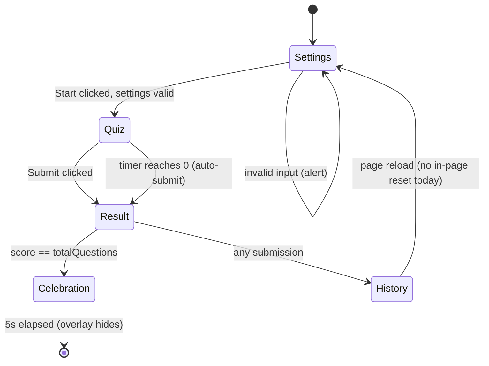
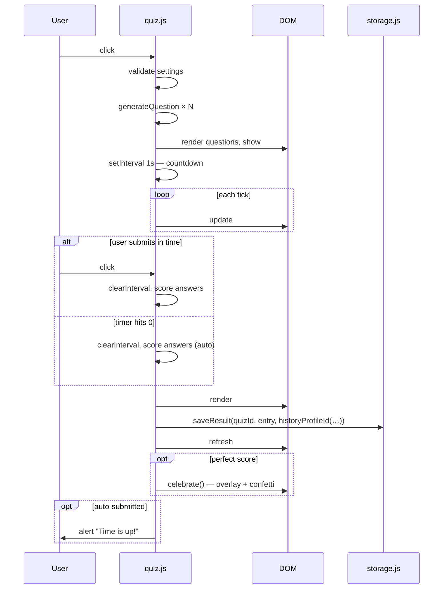
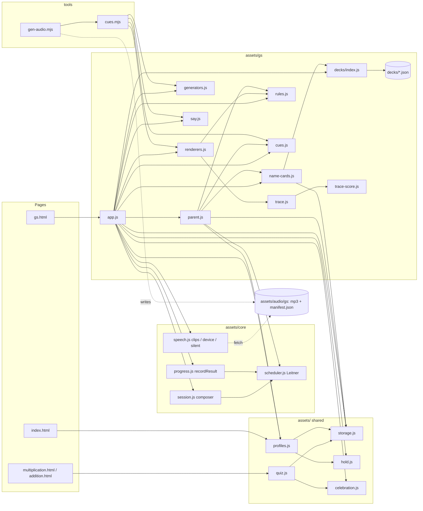
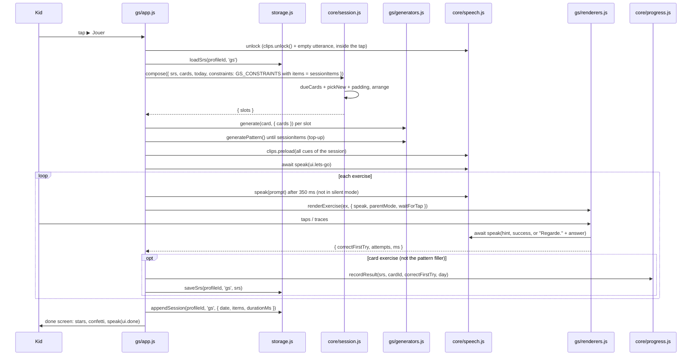
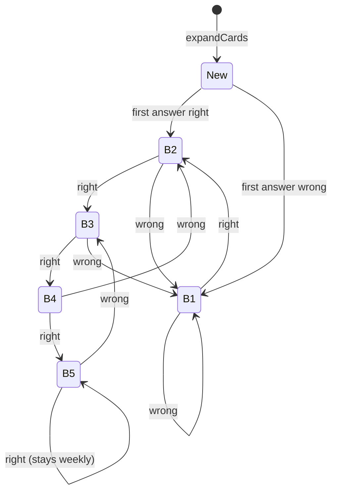

# Architecture

## Overview

`school` is a static, zero-build web app for the owner's kids: timed math quizzes for the older child, and a spaced-repetition **learning track** for the younger one (Grande Section de maternelle: sounds, letters, syllables, tracing, numbers to 10). It is hosted on **GitHub Pages directly off `main`** — pushing to `main` is the deploy. There is no build pipeline, no package manager, no CI and no backend. All persistence is browser-local via `localStorage`. Pure modules are covered by `node --test` (Node's built-in runner, no dependencies); DOM code is hand-tested.

The site is a small set of plain HTML pages sharing ES modules served as static files.

```
/
├── index.html                 # landing page: "Qui joue ?" profile picker + "Autres jeux" (math quizzes)
├── multiplication.html        # multiplication-table quiz
├── addition.html              # complement-of-addition quiz
├── gs.html                    # Grande Section learning track (one page, four screens)
├── assets/
│   ├── quiz.css, quiz.js      # math quiz styles + engine (Settings → Quiz → Result → History)
│   ├── storage.js             # versioned, namespaced localStorage layer (the only localStorage user)
│   ├── celebration.js         # confetti + congrats overlay
│   ├── profiles.js            # profile picker, profile ↔ track resolution, first-name sync
│   ├── hold.js                # long-press parental gate
│   ├── core/                  # track-agnostic learning engine (pure except speech.js)
│   │   ├── scheduler.js       # Leitner boxes
│   │   ├── session.js         # session composer
│   │   ├── progress.js        # one answered card → next SRS state
│   │   └── speech.js          # audio sources: clips / device voice / silent
│   ├── gs/                    # Grande Section track
│   │   ├── app.js             # page controller (home → session → done, parent corner)
│   │   ├── parent.js          # parent corner
│   │   ├── generators.js      # card → exercise (pure)
│   │   ├── renderers.js       # exercise → DOM, resolves with the result
│   │   ├── trace.js, trace-score.js   # tracing canvas + pure corridor scorer / pointer filter
│   │   ├── rules.js           # pure page rules (local day, daily cap, parent mode, labels)
│   │   ├── cues.js            # fixed cues spoken by app.js / parent.js
│   │   ├── say.js             # text sent to a TTS engine (stretched sounds)
│   │   ├── name-cards.js      # drops the old first name's card progress
│   │   ├── gs.css
│   │   └── decks/             # index.js (DECK_FILES, expandCards) + letters.json, numbers.json, mots-p1.json
│   └── audio/gs/              # pre-recorded mp3 clips + manifest.json + sources.json
├── tools/                     # gen-audio.mjs (clip recorder), cues.mjs (cue enumeration), README.md
├── tests/                     # *.test.mjs (node:test) + helpers/fake-storage.mjs
├── ARCHITECTURE.md            # this file
├── README.md
└── CLAUDE.md
```

## Math quizzes

### Module responsibilities

| Module | Responsibility |
|---|---|
| `assets/quiz.js` | Wires the page DOM to the quiz lifecycle. Calls the page-supplied `generateQuestion` `totalQuestions` times, manages the countdown timer, scores, renders feedback, persists results, triggers the celebration on a perfect score. History goes to the profile chosen by `historyProfileId` (see the storage schema). |
| `assets/storage.js` | The only module that touches `localStorage`. Versioned namespace `school.v1.*`, profile-aware, runs a one-shot migration of legacy keys. |
| `assets/celebration.js` | Confetti shower + congrats overlay. Returns a Promise. Also used by the GS done screen. |
| `assets/quiz.css` | Shared visual styles for the timer, celebration overlay, and confetti pieces (also loaded by `gs.html`). |
| `<topic>.html` | Standardised markup contract + a small `<script type="module">` that calls `startQuiz({ quizId, generateQuestion, validateSettings? })`. |

### DOM contract for a quiz page

Every quiz page must expose these IDs/sections — `assets/quiz.js` queries them by ID:

- `#settings`, `#quiz`, `#result`, `#history` — the four flow sections (visibility toggled with Bootstrap's `visually-hidden`)
- `#numQuestions`, `#timerDuration` — generic settings inputs
- `#startQuiz` — start button
- `#questions`, `#timer`, `#submit` — quiz section
- `#historyList` — `<ul>` for the latest 5 results
- `#celebration`, `#confetti` — overlay + confetti container (used by `celebration.js`)

Quiz-specific settings (e.g. `#complementNumber` in the addition quiz) are read directly inside the page's `generateQuestion` / `validateSettings` closures — the engine doesn't need to know about them.

### Quiz lifecycle



The Settings card hides when the quiz starts, the Quiz card hides when results render. The History card is always visible — it loads on page open and refreshes after each submission.

### Timer / auto-submit sequence



### Adding a new quiz

1. Copy `multiplication.html` to `<topic>.html`.
2. Update `<title>` and `<h1>`.
3. Inside the `<script type="module">`, change the `quizId` and replace `generateQuestion` with the new math.
4. If the quiz needs extra settings inputs (like addition's complement number), add them to the `#settings` card and read them inside the `generateQuestion` / `validateSettings` closures.
5. Add a `<li><a>` to the "Autres jeux" list in `index.html`.

Pick a unique `quizId` — it becomes part of the localStorage key (`school.v1.history.<profileId>.<quizId>`).

## Storage schema

All keys live under the `school.v1.*` namespace and are read/written only through `assets/storage.js`.

| Key pattern | Type | Notes |
|---|---|---|
| `school.v1.profiles` | `[{ id, name, avatar, track: 'gs' \| 'en', placeholder? }]` | Seeded on first visit by `profiles.js`: `kid-gs` (🦊, `gs`) and `default` (🐼, `en`), both `placeholder: true` until renamed. The 6ème child keeps the id `default` so the math history already under `history.default.*` stays his. |
| `school.v1.activeProfileId` | string | Defaults to `"default"` if absent. Written by the picker, and by `gs.html` when it has to fall back to a GS profile. |
| `school.v1.history.<profileId>.<quizId>` | `[{ score, totalQuestions, timerDuration, timeLeft, submittedAutomatically, date }]` | Math quizzes. Capped at 5 entries, newest first. Profile = `historyProfileId(profiles, activeId)`: the active profile only when its track is `'en'` (or no profiles exist yet), otherwise `'default'` — a math page opened after picking 🦊 keeps writing the older child's history. |
| `school.v1.settings.<profileId>` | `{ sessionItems, parentMode, firstName, audio, voice, extraSessionOn? }` | Defaults `{ sessionItems: 6, parentMode: null, firstName: '', audio: 'clips', voice: '' }`, merged on read. `parentMode: null` = never set by a parent (automatic, see Child UX rules); `true`/`false` = explicit. `audio`: `'clips' \| 'device' \| 'silent'`. `voice`: preferred device voice name. `extraSessionOn`: local day (`YYYY-MM-DD`) on which a parent allowed one more session. `firstName` feeds the greeting and the name-spell card. |
| `school.v1.srs.<profileId>.<trackId>` | `{ cards: { [cardId]: { box, due, seen, lapses } }, introduced: { [day]: [itemKey] } }` | Leitner state. `cardId = <deckId>/<itemId>#<skill>` (e.g. `letters/a#trace`, `mots-p1/lapin#syll-match`, `numbers/7#count`, `name/lea#name-spell`); `itemKey = <deckId>/<itemId>`. `due` and the `introduced` keys are local days. |
| `school.v1.sessions.<profileId>.<trackId>` | `[{ date, items: [{ cardId, type, correctFirstTry, attempts, ms }], durationMs }]` | Last 14 completed sessions, newest first. `date` is an ISO timestamp; the pattern filler game has no `cardId`. Drives the daily cap and the parent corner's week summary. |
| `school.v1.level.<profileId>.<quizId>` | number | Future — math difficulty progression. |
| `school.v1.achievements.<profileId>` | `[{ id, unlockedAt }]` | Future — badges. |
| `school.v1.theme` | string | Future — themes. |

`trackId` is `'gs'` today; the 6ème track will use `'en'` with the same keys. `migrateLegacyHistory()` runs once on quiz-engine init and copies any pre-namespaced `multiplicationHistory` / `additionHistory` arrays into `school.v1.history.default.<quizId>`, then removes the old keys. Idempotent.

## Learning tracks

A track = a set of decks, generators and renderers on top of a shared, track-agnostic engine. Grande Section (`gs.html`) is the only track shipped; the 6ème track (`'en'`) currently has only a profile and the math quizzes.

### Modules

| Layer | Module | Responsibility |
|---|---|---|
| core | `assets/core/scheduler.js` | Pure Leitner: `record`, `dueCards`, `boxCounts`, `addDays`; `GS_PROFILE` intervals. |
| core | `assets/core/session.js` | Pure `compose({ srs, cards, today, rng, constraints })` → `{ slots, introduced }`; `GS_CONSTRAINTS`. |
| core | `assets/core/progress.js` | Pure `recordResult(srs, cardId, correctFirstTry, today)`: `record` + daily-introduction bookkeeping. |
| core | `assets/core/speech.js` | `createSpeech` (one `speak(cue) → Promise` over ordered sources), `createClipSource`, `createDeviceSource`, `SILENT_SOURCE`, `rankVoice`. |
| shared | `assets/storage.js` | All persistence (see schema). |
| shared | `assets/profiles.js` | `ensureProfiles`, `selectProfile` (track → page: `gs` → `gs.html`; others stay on the landing page and open "Autres jeux"), `trackProfileId`, `renameProfile` / `setFirstName` (one name per child), `mountProfiles`. |
| shared | `assets/hold.js` | `holdToActivate(el, action, ms = 1500)`: long-press gate, plain taps do nothing. |
| shared | `assets/celebration.js` | Confetti on the done screen. |
| gs | `assets/gs/app.js` | Page controller: profile resolution, audio wiring, home / exercise / done screens, daily cap, quit button, gates. |
| gs | `assets/gs/parent.js` | Parent corner ("Coin des parents"): first name, items per session (5–8), parent mode, audio source + voice + "🔊 Tester", today's cap and extra session, Leitner boxes, decks, week summary and "À surveiller" (≥ 2 lapses). |
| gs | `assets/gs/decks/index.js` | `DECK_FILES`, `loadDecks`, `expandCards(decks, { firstName })` (item × skill → cards), `nameItemId`. |
| gs | `assets/gs/generators.js` | Pure `generate(card, { cards, rng })` → exercise `{ type, layout, prompt, stage, choices, success, reveal?, … }`; `generatePattern(rng)`; `phoneme`. Distractor traps (close phonemes, confusable letters, 6/9 and 1/7). |
| gs | `assets/gs/renderers.js` | `renderExercise(root, ex, { speak, parentMode, waitForTap, onSettle })` → `{ correctFirstTry, attempts, ms }`; layouts `tap`, `multitap`, `select`, `dots`, `slots`, `trace`; `UI_CUES`. |
| gs | `assets/gs/trace.js` | Model + ink canvases, Pointer Events, Pencil pressure, lift grace. |
| gs | `assets/gs/trace-score.js` | Pure corridor `score`, `keepStrokes`, `createPointerFilter`, `TRACE_HINTS`. |
| gs | `assets/gs/rules.js` | Pure: `localDay`, `dailyCapReached`, `extraSessionState`, `effectiveParentMode`, `cardLabel`, `adultHint`. |
| gs | `assets/gs/cues.js`, `say.js`, `name-cards.js` | Page cues (`PAGE_CUES`); `sayInput` (TTS input for stretched sounds); `pruneNameCards`. |
| page | `gs.html`, `index.html` | Thin shells: markup + one module (`assets/gs/app.js`, inline `mountProfiles`). |
| tools | `tools/cues.mjs`, `tools/gen-audio.mjs` | Enumerate every cue from the generators and cue tables; record one clip per key (see `tools/README.md`). |

**Dependency rule:** `assets/core/*` imports only other core modules — never `storage.js`, a track, or the DOM (except `speech.js`, which uses `Audio`/`speechSynthesis`). Tracks import core; core receives everything track-specific as arguments. What remains coupled:

- GS defaults live in core as named exports used as default arguments: `GS_PROFILE` (`scheduler.js`, `progress.js`), `GS_CONSTRAINTS` (`session.js`), the French voice preference list and `lang = 'fr'` (`speech.js`). The 6ème track must pass its own.
- `storage.js` `DEFAULT_SETTINGS` (6 items, `audio: 'clips'`) is GS-flavoured but per profile.
- `profiles.js` knows the track → page map (`TARGET`) and the track labels.



### Session flow



The profile id is captured at session start; every write is best-effort (`persist`: a full or blocked storage logs and the game goes on). An item counts as introduced only when one of its cards is answered, so an abandoned session does not burn the daily budget.

### Card lifecycle (Leitner, `GS_PROFILE`)

Intervals by box: B1 = 1 day, B2 = 2, B3 = 4, B4 = 7, B5 = 7. A card has no state until its first answer, which is recorded from box 1. "Right" means right on the first try; any miss in the exercise counts as wrong (the child still finishes the item).



### Composer rules (`compose` + `GS_CONSTRAINTS`)

- **Candidates, in priority order:** due cards (`due <= today`, lowest box first, then oldest due) → new cards → due cards left over → padding.
- **New cards:** item budget per day and kind — letters 2, words 3, numbers 1, name 1 — minus the items already introduced today; decks are introduced in deck order. A brand-new item enters with its **first skill only** (staged siblings); its other skills become new cards once that first card reached box ≥ 2, and never charge the budget again. While no `trace` card is known, the first fresh item that has a trace skill also brings its `trace` card (trace co-introduction). Fresh items and unlocked skills are interleaved.
- **Reserved new slots:** up to 2 slots are kept for new cards whenever some exist; due reviews beyond that (the highest boxes) slip to a later day, still ahead of padding.
- **Arrangement** (fills left to right, stops at the first slot it cannot fill — never compacts across a gap):
  - `trace` only at slot index 2 or 3 (one picked at random; index 3 is a fallback only when 2 was the pick and nothing fit);
  - at most 2 `numbers` cards;
  - never the same skill in two adjacent slots;
  - soft: at most 2 cards of one skill while another candidate fits (a new card in a reserved slot wins over variety);
  - soft: one easy card (box ≥ 3) in slot 0 or 1 when one exists.
- **Padding:** review cards not yet due, highest box first (shuffled within a box) — box ≥ 4 first, lower boxes only when those run out; never new cards.
- **Pattern top-up:** `app.js` appends `generatePattern()` exercises until the session has `sessionItems` items; they are not cards and are not recorded in the SRS.
- Word cards: `syll-match` / `rhyme` exist only when another word of the same deck shares the first oral syllable / the rhyme; the first skill of a word rotates by deck index (`syll-count`, `sound-pick`, then `syll-match` / `rhyme`) so early sessions stay varied. Letters start with `letter-3scripts`; `sound-letter` needs a `sound`, `trace` a `trace` model, `blend` a continuant. Numbers: `count`, `compare`, `number-line` for n ≥ 1, `decompose` for n ≥ 2. The first name gives one `name-spell` card.

### Audio

Every spoken text is a **cue** `{ key, text, display? }`. **One key → one text** (`tools/cues.mjs` throws on a second text for a known key; tests enforce it), because a clip is recorded once per key. `display` is what the page shows when it differs from what is said (letters said by name, shown written; occlusives said "beu", shown « b »).

- **Sources and fallback** (`createSpeech`, order `clips → device → silent`): the parent's choice (`settings.audio`) is the starting point and later sources are fallbacks. `clips` plays when the cue's key is in the manifest, else the device voice when a French voice exists, else silent. `device` falls back to silent. `silent` never speaks. Cues with no clip (first-name letters, the first-name success line) always fall through to the device voice.
- **Clip path:** `assets/audio/gs/<key with '.' replaced by '/'>.mp3` (`ui.blend.fa` → `assets/audio/gs/ui/blend/fa.mp3`); keys are ASCII. `manifest.json` (sorted key list) is fetched at page load; no manifest → device voice.
- **Preload:** at session start, every clip the session can play (prompts, successes, reveals, choice and trace cues) is fetched once to warm the HTTP cache.
- **Timeout:** `speak()` always resolves — on end, error, or a deadline of `max(1500 ms, 110 ms × text length)`, plus 2.5 s for clips until their metadata arrives; once the clip duration is known the deadline is re-armed to the remaining duration + 1 s. On timeout the source is stopped first, so a late clip never plays over the next cue. A new `speak()` stops the current one: never two at once.
- **Device voice:** Web Speech, `fr*` voices only (never the default English voice), ranked by a preference list (premium/enhanced first, novelty voices last) or the parent's choice; rate 0.85. Its text goes through `sayInput` (`assets/gs/say.js`) — the same transform `gen-audio.mjs` uses — so "fff" is a stretched sound, not three letter names.
- **iOS unlock:** inside the ▶ Jouer tap, `clips.unlock()` plays a silent WAV on the single shared `Audio` element and an empty utterance primes `speechSynthesis`; the first real cue ("C'est parti !") is spoken in the same flow. The 🌙 tap unlocks the same way.

### Child UX rules

- **The child cannot read.** Each prompt is spoken automatically 350 ms after the screen appears (🔊 pulses) and 🔊 replays it; any touch in the exercise cancels a pending autoplay. Long-press on a choice speaks it.
- **Nothing advances while audio plays.** The renderer awaits the success (or reveal) cue, then 400 ms, then the next exercise.
- **Two-miss rule:** the second miss reveals the answer — "Regarde." then the answer is said; never praised, recorded as wrong. In tap games a wrong choice shakes, then hides for 3 s.
- **Trace:** a stroke too short to be scored (< 8 points, a stray tap) is not a miss and is dropped. Success = coverage ≥ 0.85, < 25 % of ink outside the corridor, first point near the green start dot; otherwise one hint ("Pars du point vert.", "Suis le chemin gris.", "Presque ! Reste dans le chemin."). The ink clears 1.2 s after a failed attempt; a lift under 0.9 s continues the same attempt. After two hinted misses the letter is said and a "Suivant ▶" button appears (no praise, canvas stays live). Pointer filter: once a Pencil is seen, finger/palm touches are ignored until 30 s without Pencil input; palm ink drawn before the Pencil landed is dropped.
- **Parent mode** (`effectiveParentMode`): explicit `true`/`false`, or automatic when `parentMode` is `null` — on when the device cannot speak French (no French voice, and not "clips selected with clips available"). Effects: a written adult line on blend and trace exercises (never spoken), no automatic reveal, and a "Suivant ▶" tap before each next exercise.
- **Silent mode** (`audio: 'silent'`): 🔊 hidden, the consigne is labelled for the adult (`👩‍🏫 À lire`), no autoplay, "Suivant ▶" tap between exercises.
- **Daily cap:** one completed session per local day. Afterwards home shows 🌙 and "À demain" instead of ▶ Jouer (tapping 🌙 says to come back tomorrow). The parent corner can allow exactly one more session today (`extraSessionOn`).
- **Parental gates:** ⚙️ (parent corner) and 🦊 (back to the profile picker) on `gs.html`, and ✏️ (rename profiles) on `index.html`, act only on a 1.5 s long-press that fills the button; a tap does nothing. 🏠 (quit a session) needs a 0.8 s hold or two taps within 2 s.
- **Typography:** non-breaking space before `! ? : ;` in every French string; data texts always go through `textContent`.

## Local development

There is no build. Serve the directory (ES modules and `fetch` of the decks need a real origin):

```
python3 -m http.server 8000
# http://localhost:8000/
```

Tests: `node --test` from the repo root (no argument — Node 22.7 treats `node --test tests/` as a module path and fails). Discovery finds `tests/**/*.test.mjs`.

## Conventions

- Bootstrap 5.3 from CDN with SRI hashes pinned. Don't drop the integrity hashes when changing the version.
- Use Bootstrap utility classes for layout. Custom CSS only for things Bootstrap doesn't provide (animations, the timer typography, the GS screens in `assets/gs/gs.css`).
- Don't introduce a build step, framework, or package manager without a concrete reason (there is deliberately no `package.json`; the `MODULE_TYPELESS_PACKAGE_JSON` warning in test output is cosmetic).
- localStorage writes go through `assets/storage.js`. Pages must not call `localStorage.getItem/setItem` directly.
- Keep core modules pure and track-agnostic; put track decisions in `assets/<track>/` and pass them in.
