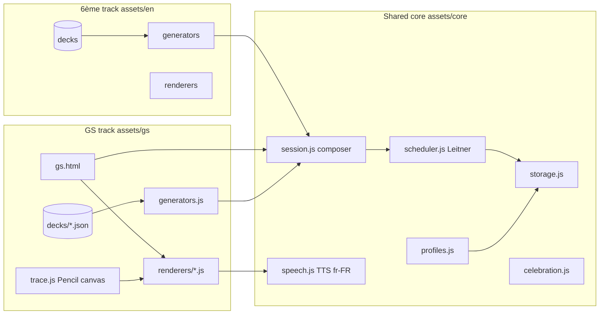
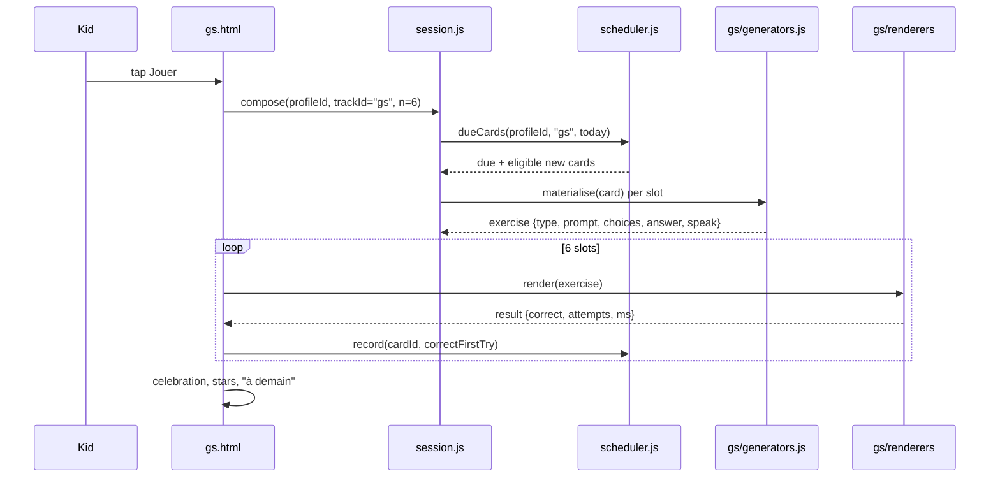
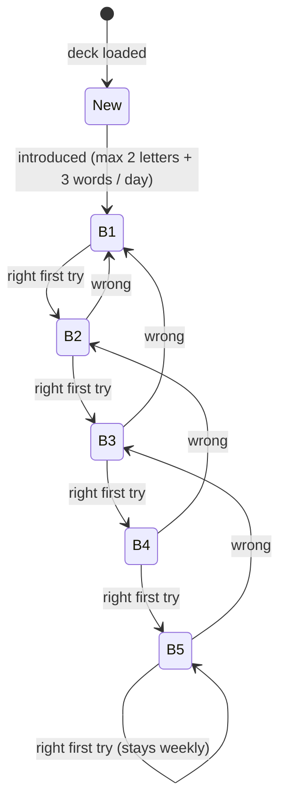

# Grande Section track — design spec

Date: 2026-10-17 · Status: approved direction (chat, 2026-10-17), spec for review
Mockup: https://claude.ai/artifact/Anxe69TYVpyqkr8hcAYGw4 (private). 6ème mockup for the shared pieces: https://claude.ai/artifact/8NS1t8vgeEGq3g3nhC94Sm.

## 1. Goal

Give the youngest child (Grande Section, 5–6, school year 2026-2027) a **6-minute daily training** on the three things the GS programme and the September-CP evaluation actually look at: sounds (syllables, phonemes), letters (name, 3 scripts, sound, cursive tracing) and numbers to 10 (count, read, decompose, compare), plus patterns and her first name. Training, not assessment. One button for the child, zero daily admin for the parent, iPad + Apple Pencil as the primary device.

Non-goals: reading words (that is CP), handwriting recognition, speech recognition, any backend, any build step, any paid asset.

## 2. Grounding

### 2.1 Programme in force

- Arrêté du 16 avril 2026, BO n°19 du 7 mai 2026 (JO 6 mai 2026, NOR MENE2608627A). Applies from September 2026 to all cycle 1 levels, abrogates the 2015 programme, keeps the French and maths contents of BO n°41 du 31 octobre 2024, now in six domains. Consolidated text: eduscol `programme-cycle-1-consolide-127565.pdf`.
- GS objectives ("à partir de 5 ans") used by this design, paraphrased from that text:

| Area | GS objective | In this track |
|---|---|---|
| Syllables | remove / add / swap / fuse syllables; rhymes and assonances | `syll-count`, `syll-match`, `rhyme` |
| Phonemes | hear, discriminate, manipulate; locate a phoneme in a word; odd-one-out at the initial | `sound-pick`, `sound-letter` |
| Letter names | all letters in the 3 scripts (capitale, script, cursive); tell apart b/d, c/e/o, p/q; spell one's first name | `letter-3scripts`, `name-spell` |
| Letter sounds | sound of the letters "except the occlusives": vowels, s r f v j ch, l | `sound-letter`, `blend` |
| Writing | cursive letters and ligatures; first name without a model; transparent words in cursive | `trace` |
| Numbers | collections to 10 and beyond; quantity ↔ name ↔ digit; decompositions 2→10 said aloud ("5, c'est 3 et 2"), fingers of both hands; compare by digit; count to 30, back from 10; number line to 10 | `count`, `decompose`, `compare`, `number-line` |
| Patterns | organised motifs | `pattern` |

- **Phoneme blending into words is a CP skill, not a GS expectation.** The observed difficulty (she cannot chain the letter sounds the parent gives her into the word) is age-normal. The bridge the programme itself suggests is stretching continuant consonants; the track offers it as `blend` (consonne continue + voyelle, listening first) and never asks her to read a word.

### 2.2 Repères CP (September 2026) — what GS prepares

Source: eduscol `26cpguidedesscores-129814.pdf`. Every French item is "listen, then circle a picture or a letter"; every maths item is "circle a number". That is exactly a tap exercise.

| Repères CP item | Format | Track exercise |
|---|---|---|
| Ex. 3 / 10 — syllabe d'attaque / syllabe finale | circle the picture | `syll-match` |
| Ex. 17 / 18 — phonème initial / final | circle the picture | `sound-pick` |
| Ex. 2 — the 3 scripts of a dictated letter (weakest skill nationally, 68.7 % in 2025) | circle the 3 letters | `letter-3scripts` |
| Ex. 15 — initial sound → letter | circle the letter | `sound-letter` |
| Ex. 7 — count a collection ≤ 10 | circle the number | `count` |
| Ex. 5 — read dictated numbers 0–10 | circle the number | `count` (digit side) |
| Ex. 8 — compare two numbers (timed) | cross the bigger | `compare` |
| Ex. 14 — number line | circle the number | `number-line` |

Known traps from the same guide drive the distractor rules: visually close letters (b/d, m/n, u/v, a/o cursive), close phonemes (f/v, p/b, m/n), rhyming distractors (lapin/sapin), 6/9 and 1/7.

## 3. Platforms surveyed

| Platform | What it does well | Why it does not close the gap |
|---|---|---|
| Lumni (France TV) | free, ad-free, French | video and quizzes, no drill, no scheduling, no classroom match |
| Bayam (Bayard) | ages 5–6 shelf, French, polished | paid, play and culture, nothing on cursive or classroom words |
| Lingokids | strong game design | English-learning product, paid |
| Khan Academy Kids | free, excellent for numbers | English-only interface |
| Kaligo | best cursive tracing (Dumont font, Pencil) | subscription; writing only |
| GraphoLearn FR | validated decoding game (Ziegler, LPC) | targets CP decoding, too early |
| Lalilo | adaptive reading prep | school-licensed, teacher-driven |
| 1000 mots | cheap phonology (3.99 €) | fixed word bank, cannot add class words |
| Printable fiches (pass-education, logicieleducatif) | match the programme | parent-run, no scheduling, no audio |

Use: nothing to buy. Lumni/Bayam stay optional entertainment. The track covers the three gaps: classroom words, cursive tracing in the browser, and the mixed daily session.

## 4. Where the 6ème principle holds and where it does not

Principle: one deck → many exercise types generated automatically → Leitner → automatic daily session.

Holds:
- Deck → generated exercises: a word deck yields `syll-count`, `syll-match`, `sound-pick`, `sound-letter`, `rhyme`; the alphabet deck yields `letter-3scripts`, `sound-letter`, `trace`; the number deck yields `count`, `decompose`, `compare`, `number-line`.
- Scheduler, session composer, profiles, celebration: reused as is.

Does not hold, and the design changes accordingly:
- **A card is (item, skill), not an item.** "a" is five cards (name, 3 scripts, sound, trace, in-word). Leitner state lives per card.
- **Intervals cap at 1 week** for GS (boxes 1d / 2d / 4d / 1w / 1w) and new cards enter slowly (≤ 2 new letters, ≤ 3 new words per day). A 5-year-old does not need a 3-week box; she needs daily contact.
- **No typed input anywhere.** Tap, drag, trace, listen. No text she must read, every instruction has a speaker button and is spoken on arrival.
- **Guided play beats retrieval drill**: a Parent mode toggle keeps the child-facing screens identical but adds a one-line prompt for the adult ("Faites-lui étirer le fff") on `blend` and `trace`, and never auto-advances.
- **Session is 6 items, 5–8 minutes**, composed for variety (never the same type twice in a row, exactly one `trace` slot, at most two number items), not for coverage.
- **Errors are hints.** Wrong choice shakes and hides for a few seconds; the right answer is spoken; no score shown to the child, stars only.

## 5. Architecture



- `index.html` becomes the profile picker (writes `school.v1.activeProfileId`, already honoured by `storage.js`).
- `gs.html` is one page, one `<script type="module">`, same thin-shell convention as today's quiz pages.
- `assets/core/*` is shared with the 6ème track; the 6ème spec (not yet written) must consume these same modules. Whichever track ships first creates them.
- `assets/quiz.js`, `multiplication.html`, `addition.html` are untouched; the math quizzes keep working.

### 5.1 Session flow



### 5.2 Card lifecycle (Leitner, GS profile)



Intervals: B1 = 1 d, B2 = 2 d, B3 = 4 d, B4 = 7 d, B5 = 7 d. A wrong answer after the first attempt in the same exercise counts as wrong for the card but the child still finishes the item.

## 6. Data model

### 6.1 Decks (`assets/gs/decks/*.json`, shipped static)

```json
{
  "id": "gs-mots-p1", "kind": "words", "label": "Mots de la classe · période 1",
  "items": [
    { "id": "lapin", "text": "lapin", "emoji": "🐰", "syll": ["la","pin"], "phon": ["l","a","p","ɛ̃"], "say": "lapin" }
  ]
}
```

Kinds and the fields each needs:

| kind | items | required fields | generated skills |
|---|---|---|---|
| `letters` (invariant, 26) | a–z | `cap`, `script`, `cursive`, `name` (say), `sound` (null for occlusives), `trace` (waypoints), `confusables` | `letter-3scripts`, `sound-letter`, `trace`, `blend` (continuants only) |
| `words` (per période, 15–20) | class words | `text`, `emoji`, `syll[]`, `phon[]`, `say` | `syll-count`, `syll-match`, `sound-pick`, `rhyme`, `sound-letter` |
| `numbers` (invariant, 0–10) | 0..10 | `digit`, `say`, `dice`, `fingers` | `count`, `decompose`, `compare`, `number-line` |
| `name` (1 item, parent setting) | first name | `text` | `name-spell`, `trace` (word mode) |
| `patterns` (generated, no file) | — | — | `pattern` |

Emoji are the default picture, as in the 6ème design; the word deck author checks that each emoji is unambiguous for a 5-year-old (no emoji → no word).

### 6.2 Card ids and storage keys

Card id: `<deckId>/<itemId>#<skill>`, e.g. `gs-lettres/a#trace`, `gs-mots-p1/lapin#syll-match`, `gs-nombres/7#count`.

| Key | Value |
|---|---|
| `school.v1.profiles` | `[{ id, name, avatar, track: "gs" \| "en", born?: "2021-03" }]` (already reserved in ARCHITECTURE.md) |
| `school.v1.activeProfileId` | string (exists) |
| `school.v1.srs.<profileId>.<trackId>` | `{ cards: { [cardId]: { box, due, seen, lapses } }, introduced: { "2026-10-17": ["gs-lettres/a", …] } }` |
| `school.v1.sessions.<profileId>.<trackId>` | last 14 `{ date, items: [{ cardId, type, correctFirstTry, attempts, ms }], durationMs }` |
| `school.v1.settings.<profileId>` | `{ sessionItems: 6, parentMode: false, firstName: "…", voice: "fr-FR/…", tracing: "auto" }` |

All writes go through `storage.js` (new functions `loadSrs/saveSrs`, `loadSettings/saveSettings`, `appendSession`, `loadProfiles/saveProfiles`). Profiles and settings are per child; the 6ème track reuses the same keys with `trackId = "en"`.

## 7. Exercise catalogue

| type | skill tested | prompt (spoken, French) | choices / interaction | validation | Repères CP |
|---|---|---|---|---|---|
| `syll-count` | segment syllables | "Combien de syllabes dans chapeau ?" | 3 tiles ● / ●● / ●●● | tap | — |
| `syll-match` | shared initial or final syllable | "Quel mot commence comme la-pin ?" | 3 emoji, 1 shares the syllable; 1 distractor rhymes | tap | ex. 3 / 10 |
| `rhyme` | rhymes | "Qu'est-ce qui rime avec chapeau ?" | 3 emoji | tap | — |
| `sound-pick` | initial / final phoneme | "Quel mot commence par fff ?" | 3 emoji; distractor shares the place of articulation (f/v) | tap | ex. 17 / 18 |
| `sound-letter` | phoneme → grapheme (continuants only) | "fffusée. Quelle lettre chante au début ?" | 3 letters (one confusable, one close phoneme) | tap | ex. 15 |
| `letter-3scripts` | 3 scripts of a letter | "Trouve toutes les lettres A" | 6-tile grid, 3 targets (cap / script / cursive), 3 confusables | multi-tap until all 3 | ex. 2 |
| `blend` | oral fusion C+V | "Colle les sons" | two tiles play "fff", "aaa", then the fused syllable; 3 syllable tiles | tap | bridge to CP |
| `trace` | cursive letter / digit / first name | "Trace le a. Pars du point vert" | canvas, Pencil or finger | corridor score (§8) | — |
| `name-spell` | first name letters in order | "Écris ton prénom" | shuffled capital tiles → slots | tap in order | — |
| `count` | cardinal ≤ 10, read digit | "Combien de pommes ?" | collection (organised or scattered), 6 digit tiles | tap | ex. 7 / 5 |
| `decompose` | decompositions 2→10 | "5, c'est 3 et encore… ?" | 3 lit dots, light more, confirm | count == target | — |
| `compare` | compare quantities then digits | "Où y a-t-il le plus ?" | 2 collections, then 2 digits | tap | ex. 8 |
| `number-line` | position on 1–10 line | "Quel nombre manque ?" | line with a gap, 3 digits | tap | ex. 14 |
| `pattern` | ABB / ABAB continuation | "Qu'est-ce qui vient après ?" | 6-tile sequence + blank, 3 emoji | tap | — |

Generation rules common to all: 3 choices (6 for digits), distractors drawn from the trap lists in §2.2, never two identical emoji in a set. **The child cannot read: every prompt is spoken automatically ~350 ms after the screen appears, and the large 🔊 button (≥ 56 px, pulses once on arrival) replays it as many times as wanted; no exercise ever depends on reading the on-screen text.** Choices are also spoken on long-press (word, letter name, number). Correct answer re-spoken on success, never more than two consecutive misses on the same card in a session (the second miss shows the answer and moves on).

## 8. Tracing engine (`assets/gs/trace.js`)

- Two stacked canvases: model (gridlines at 30/50/70 %, grey corridor, green start dot, direction arrows, dot for i/j) and ink.
- Pointer events only (`pointerdown/move/up/cancel`, `setPointerCapture`), `touch-action: none` on the box. When a `pointerType === "pen"` event has been seen in the session, `touch` pointers are ignored (palm rejection); otherwise finger and mouse draw. Line width follows `pressure` for the pen.
- Letter model = polyline of waypoints in a 100×100 box, hand-authored per letter, including the entry and exit strokes used in French cursive (the ligature stub). Models are drawn by code, not by a font, so no font licence question for the corridor. If a font is wanted for displayed words, use **Marelle** (ministry cursive, OFL); not Dumont (commercial).
- Score: coverage = waypoints within radius 9 of any ink point; outside = ink points farther than 13.5 from every waypoint; start = first ink point within 12.6 of the start dot. Success when coverage ≥ 0.85, outside < 0.25 and start ok. Order is enforced by requiring the first touched waypoint to be the start; full stroke-order checking is deferred.
- Feedback copy: "Pars du point vert", "Suis le chemin gris", "Presque ! Reste dans le chemin", "Super a !".
- Not in scope: handwriting recognition, Kaligo-like per-segment correction.

## 9. Audio (`assets/core/speech.js`)

**Decision (2026-10-17, after testing the mockup on the Mac): pre-generated clips are the primary audio; device TTS is the fallback.** Web Speech only exposes the operating system's voices; Apple ships compact, robotic French voices by default and the enhanced ones are an optional download the family may never do, and the iPad will not sound like the Mac. The vocabulary is finite (26 letter names + sounds, 11 numbers, 15–20 words per période, ~30 instruction sentences, a few feedback lines), so clips are cheap.

**Audio is a swappable source behind one interface.** `speech.js` exposes `speak(cue) → Promise<void>` (resolves when playback ends, or on a timeout) and `setSource(name)`. Sources implement `{ canPlay(cue), play(cue) → Promise, stop() }`:

| source | what it plays | when |
|---|---|---|
| `clips` | pre-generated mp3 per cue (below) | default once a deck ships clips |
| `device` | Web Speech with explicit fr-FR voice | fallback, and for text with no clip |
| `parent` | clips the parent recorded on the device (later) | overrides `clips` per cue |
| `silent` | nothing; the consigne is shown as an adult cue ("👩‍🏫 À lire : …"), no autoplay, 🔊 hidden, no auto-advance | adult runs the session with the child, or no usable voice |

The parent corner chooses the source (Clips / Voix de l'appareil / Aucune voix, un adulte lit) and, for `device`, the voice. Stored in `settings.audio`. Adding a cloud TTS or another engine later means adding one source, not touching exercises.

**Sequencing rule (confirmed on the mockup): nothing advances while audio plays.** Success feedback → `await speak()` → 400 ms → next screen → its consigne. Starting a new cue cancels the previous one only on an explicit user tap (🔊 or a choice), never by the engine's own auto-advance.

- Clips live next to the deck: `assets/gs/audio/<deckId>/<itemId>.<variant>.mp3` (`variant` = `name`, `sound`, `word`, `syll-1`…), plus `assets/gs/audio/ui/<key>.mp3` for instructions and feedback. Each deck item lists its clips; `speech.js` exposes `speak(key | text)`: clip if present, else TTS.
- Generation happens at deck-authoring time in the Claude Code session that builds the deck (admin path B): one script, one neural voice for the whole site (candidates: Azure `fr-FR-DeniseNeural`, Google WaveNet fr-FR, OpenAI TTS; or `say -v "Audrey (Premium)"` on the Mac once downloaded), 64 kbps mono mp3, ~5 KB per clip; a full track is under 2 MB. Stretched sounds ("fff", "sss") are recorded as real clips, which no TTS renders correctly.
- Playback: one `Audio` element unlocked on the "Jouer" tap (iOS requires a gesture), clips preloaded per session, never two at once.
- Dynamic sentences that cannot be pre-recorded (e.g. "5, c'est 3 et 2") are assembled from number and word clips with 120 ms gaps; TTS is the last resort.

TTS fallback rules (kept for dynamic text and for decks that ship without clips):
- Web Speech API `speechSynthesis`. **Confirmed on the mockup (2026-10-17): speaking before the voice list has loaded makes the browser read French text with its default English voice**, which a child cannot follow. So: never speak without an explicit `fr-*` `SpeechSynthesisVoice`; load the list on `voiceschanged` and again lazily; pick by a preference list (Thomas, Amélie, Audrey, Marie, Google français, Microsoft Paul/Julie/Hortense), then any local `fr-FR`, then any `fr-*`; persist the parent's choice in settings; rate 0.85, pitch 1.05.
- Parent corner: voice `<select>` with a test sentence, a warning when no French voice exists (Parent mode then defaults on), and the iPad tip (Réglages › Accessibilité › Contenu énoncé › Voix › Français, download "Thomas" or "Audrey (Premium)"; the enhanced voices are the only ones clear enough for a 5-year-old).
- iOS constraints: `getVoices()` is empty until `voiceschanged`; the first utterance must be inside a user gesture (the "Jouer" tap); `speechSynthesis.cancel()` before each new utterance. The home screen speaks a greeting on "Jouer" to unlock audio.
- Later option: the parent records their own voice per item (MediaRecorder, stored through `storage.js` in IndexedDB) and it overrides the generated clip. Not in v1.

## 10. Session composer (`assets/core/session.js`)

Pure function `compose({ srs, decks, settings, today, rng })` → `exercise[]`:

1. Collect due cards (`due <= today`), sort by box ascending then by `due`.
2. Introduce new cards up to the daily budget per deck kind (letters 2, words 3, numbers 1) in deck order (letters follow the classroom order of the période if the word deck declares `letterOrder`, else vowels then continuants then the rest).
3. Fill 6 slots with constraints: slot 3 or 4 is `trace`; at most 2 number cards; no type twice in a row; at least one "easy" card (box ≥ 3) in the first two slots.
4. If fewer than 6 cards are available, pad with review of box ≥ 4 cards, never with new ones.
5. Track-agnostic: the 6ème track passes its own constraints object.

Keeping `scheduler.js`, `session.js` and the trace scorer pure (no DOM, no storage) lets a `tests.html` page assert them in the browser without introducing a test framework.

## 11. Screens (see mockup)

1. Profiles (`index.html`): two big avatar cards, gear → parent corner.
2. Home: greeting, today's preview (what will be practised), stars this week, **Jouer**.
3. Exercise screens: top bar (progress dots, ✖), spoken instruction with 🔊, big choices, feedback line. One layout per type listed in §7.
4. Done: confetti (reuse `celebration.js`), stars, "à demain pour…" built from tomorrow's due cards.
5. Parent corner: duration (5–8 min), audio source (clips / device voice / none, adult reads) with voice picker and test sentence, Parent mode, first name, Leitner box counts, deck list with période label, week summary and "à surveiller" (cards with ≥ 2 lapses).

Visual: Bootstrap 5.3 from CDN for layout as elsewhere in the repo; custom CSS for tiles, trace box, confetti. Fredoka or equivalent rounded display face from Google Fonts for headings; body in the system stack. Tap targets ≥ 56 px. Works at 390 px wide and on iPad portrait.

## 12. Admin paths (parent)

- A. Invariant decks ship in the repo (letters, numbers, patterns rules).
- B. Classroom word deck per période: parent photographs the cahier de vie / mots de la période; a Claude Code session produces `gs-mots-p<N>.json` (syllables and phonemes checked by hand), pushed to `main`. Same path as the 6ème "Pronote inbox → deck JSON".
- C. First name typed once in the parent corner.
- No in-app deck editor in v1.

## 13. Risks and open questions

| # | Risk / question | Mitigation |
|---|---|---|
| R1 | Device TTS quality (confirmed on the Mac: default French voices are compact and robotic, enhanced voices are not installed; English voice used when the list is not awaited) | pre-generated neural clips as primary audio (§9); TTS only as fallback with explicit fr-FR voice selection and a picker; Parent mode fallback |
| R2 | Pencil palm rejection in a web page | pointerType filter; full-screen PWA add-to-home-screen to avoid Safari gestures |
| R3 | Emoji ambiguity for a 5-year-old | deck author rule: every emoji validated with the child once; `say` always spoken |
| R4 | Over-drilling / boredom | hard cap 1 session/day, 6 items, variety constraints, stars not scores |
| Q1 | What material comes home (cahier, mots, comptines)? | drives deck B; until known, ship letters + numbers + a 15-word generic GS deck |
| Q2 | Should the 6ème track consume `assets/core/*` first, or GS? | whichever ships first creates the core; the other adapts. Decide at planning |
| Q3 | Keep `assets/quiz.js` math quizzes on `index.html`? | yes, behind the profile picker, untouched |

## 14. Manual test plan (no framework, per CLAUDE.md)

- `tests.html` (local, not linked from the site): asserts for `scheduler` (box moves, interval caps, lapse rule), `session.compose` (constraints hold on 200 random seeds), `trace.score` on three recorded strokes (good, wrong start, off-corridor).
- Device pass on the iPad with Pencil and finger: every exercise type once; TTS unlock from "Jouer"; palm on the glass while tracing; rotate; add-to-home-screen.
- Phone pass at 390 px: no horizontal scroll, tiles ≥ 56 px.
- Storage pass: two profiles, sessions recorded under the right `profileId`, math quizzes still save history.
- Child pass: one real 6-minute session with Parent mode on, note where she stalls; adjust copy before pushing to `main`.
