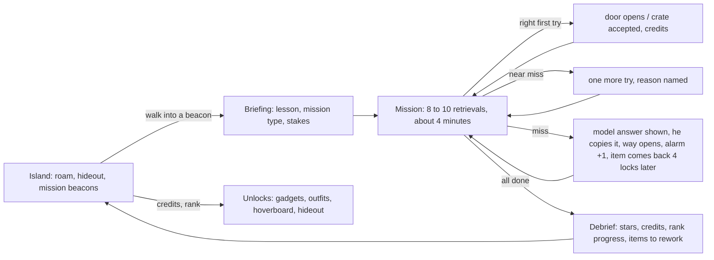
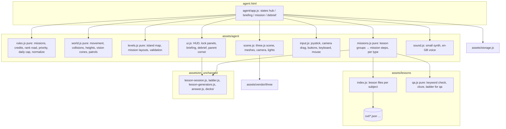

# Agent L — a 3D spy game that trains Louis on his lessons

Date: 2026-11-20 · Status: approved by the parent on 2026-11-20 · Working title: **Agent L** (`agent.html`)

## Intent

Louis (6ème) should *want* to revise. He likes building games and short arena fights, and dreams of open-world,
stealth and spy games. The game gives him that kind of play (a small open island, stealth missions, gadgets,
unlocks) and makes **recalling his lessons the action that moves the game forward**.

### What the school record showed (read with the parent on 2026-11-20)

The marks themselves stay out of this public repo. The pattern: he understands and speaks well, and he loses
points when he must **write from memory** what he learned (written memory tests in English, lesson quizzes,
recitation, conjugation). Oral work, maths and problem solving are solid.

So the game's core is **written retrieval of the exact lesson content, spaced over days**, for any subject.
English and SVT come first (the parent's ask); the same mechanics then take physics, French, German, history.

Pronote publishes lesson *titles* and some PDFs, not the lessons. Content comes from notebook photos or teacher
PDFs, turned into one lesson file by a Claude session, as the English track already does.

## Goals

1. Louis plays on his own initiative, in sessions of 5 to 25 minutes, on the family iPad (Safari); Mac/PC also work.
2. Every mission makes him retrieve lesson items; progress in the game requires progress on the lessons.
3. English: he *writes* (spelling, capitals, dates, time), and hears and reads simple English in the world.
4. SVT: he recalls the answers to the teacher's "questions to know", sorts and orders the chapter's notions.
5. A new lesson = **one data file, no code change**, playable the day it is pushed.
6. One learning state per lesson: what he does in the game and in `en.html` counts in both.
7. Stays in this repo: static files, no build step, push to `main` = deploy.

## Non-goals

- Looking like a AAA game. The look is a clean, stylised low-poly indie game.
- Multiplayer, chat, accounts, a backend, analytics, ads, external links.
- Teaching a lesson for the first time. The game is practice after class.
- Replacing `en.html` or changing its behaviour. Game controller support. Offline play. A level editor.
- Automated Pronote access. A Claude session reads Pronote on request, read-only.

## Anti-goals (a failure even if it works)

- A quiz gate in front of unrelated fun. The answer must be the action, in the fiction.
- Time pressure on writing; a miss that blocks, ends the mission or takes back a reward.
- Rewards for grinding what he already masters, or for play without learning.
- Violence against people, or names, characters or looks taken from an existing game.
- A praised or paid revealed answer.

## Constraints

- Repo rules: no build, no framework, no package manager; `localStorage` only through `assets/storage.js`; pure
  modules tested with `node --test`; `main` is production.
- 3D: **three.js 0.187.0, vendored** as its ES module build files under `assets/vendor/three/` (MIT licence file
  kept beside them), imported by relative path. Reason: no build, no CDN dependency at play time, no SRI gap on
  module imports. WebGL only.
- All geometry is built in code from primitives (flat-shaded boxes, cylinders, cones), instanced or merged. No
  external 3D models, textures or fonts.
- iPad Safari: 60 fps target, device pixel ratio capped at 2 and lowered automatically when frames get slow;
  audio and speech unlocked inside a tap; typed inputs keep `autocorrect`, `autocapitalize`, `autocomplete` and
  `spellcheck` off.
- French UI text is correct French (non-breaking space before `! ? : ;`); data text goes through `textContent`.
- Existing lesson item ids are never renamed.

## Approaches considered

| | Concept | Trade-off |
|---|---|---|
| **A (picked)** | Spy missions on a small open island: stealth, terminals, field work | The lessons fit the fiction (codes are typed answers; briefings are English). Biggest build. |
| B | Block builder: mine and build, each resource costs an answer | Best long-term reward, but the answer is a toll, lessons have no place in the world, and he owns the real thing. |
| C | Arena brawler: 2-minute fights, answers recharge the super | Smallest build and most replayable, but speed favours tapping a choice over writing: the opposite of his need. |

The parent picked **A** on 2026-11-20, taking from C the short sessions and the reward road, and from B a hideout
he builds (phase 2).

## The game

### Fiction and tone

Louis is Agent L. A rogue AI, **GLITCH**, has taken over the systems of Cobalt Island with its guard robots and
drones. Each mission takes a building back. Light, funny, no people hurt: robots are stunned, never destroyed in a
gory way; nobody dies. Names and look are original.

### Core loop

### The island (hub)

Third-person, free roaming, about 300 m across. Districts are places for lessons, and their signs are in English,
taken from his decks where a word exists (LIBRARY, CANTEEN, PLAYGROUND…).

| District | Role |
|---|---|
| Harbour + hideout | Start, unlocks, trophies, parent corner |
| Cobalt Academy | English missions |
| Market, farm and dairy | SVT missions |
| Clock Square, radio tower, power station | Phase 2 (time, dictation, physics) |

A mission beacon stands in front of a building for every playable lesson. Rooftops hold collectible data chips
(exploration reward, small credits, no learning attached, capped).

### Mission types

A mission type is a reusable mechanic fed by a lesson's groups. Which type a group can use depends on its `kind`.

| Type | Phase | Fed by | What he does |
|---|---|---|---|
| **Infiltration** | 1 | `spell`, `write`, `grammar`, `vocab`, `qa` | Sneaks through a compound past patrolling robots. Each locked door or terminal asks one item; the world pauses while he answers. The format follows the item's ladder level: pick a keycard → complete with letter tiles → type → dictation. |
| **Sort run** | 1 | `sort` | Carries or throws crates into the right zone (animal / plant / mineral origin; conservation method…) while drones patrol. |
| Lab | 2 | `order` | Restarts a production line by activating stations in the right order (the yoghurt line). |
| Rendez-vous | 2 | `vocab` with a place, time generator | A contact speaks English: "Meet me at the library at a quarter past four." He goes there and sets the clock. |

Infiltration takes every typed or picked kind, so **any lesson is playable with no code**.

Stealth and knowledge are kept apart on purpose:

- Seen by a robot: it chases; caught = back to the last opened door. Nothing learned is lost, no game over.
- Stars (1 to 3) come only from first-try answers. Stealth earns a small style bonus, never stars.
- No timer on an answer. A wrong answer raises the alarm level (more patrols for the rest of the mission), shows
  the model answer, has him copy it once, then opens the way. The item returns as the lesson composer decides
  (see Learning model): 4 locks later, in the other format, recorded.
- The hint drone turns the answer into a `retry` result: the way opens, the item does not climb.

Mission layouts are small hand-written grid maps (walls, doors, terminals, patrol paths, spawn, exit) with 10
locks. A mission draws a layout at random; an item is bound to a lock when he opens it, because the composer picks
each exercise from the answers before it. If the composer has nothing left, the remaining doors open by
themselves.

One beacon per lesson. A lesson whose groups feed several mission types (SVT chapter 3: `qa` and `sort`) offers
one type per run: the type whose groups hold the most due or still-learning items, never the same type twice in a
row when another one has something to play.

### Language

- Chrome and teaching feedback: French. Lesson cues and consignes: as written in the lesson file.
- English missions: briefing spoken (device en-GB voice) and shown in very simple English; a tap shows the French,
  at no cost. In-world signs are English.

### Progression and rewards

- **Credits**: per first-try answer and per mission star. An item that is not due and already mastered pays a
  token amount, so grinding a known lesson is pointless.
- **Mastery pays most**: an item confirmed on a second day (the ladder's "mastered") pays a bonus, which is what
  brings him back tomorrow.
- **Rank road** (the short-session reward loop): experience only goes up; each rank opens items he then buys
  with credits in the hideout. Ranks open gadgets (EMP that freezes a robot for 5 s; a hint drone that
  shows the first letter and makes the answer count as not first-try), outfits and the hoverboard.
- **Priority missions**: each day up to 3 beacons are flagged and pay double on their first finished run: a lesson
  whose test is within 7 days first, then the lesson with the most due or weak items, then the one played longest
  ago.
- **Daily cap**: `maxMissions` per day (parent corner, default 6); roaming and the hideout stay open.
- Phase 2: the hideout becomes a block builder (the Minecraft itch) paid with credits.

## Learning model

### English lessons: reuse, do not fork

The game is a second front end on the existing pure modules: `assets/en/decks/index.js` (lesson loading),
`lesson-session.js` (`nextStep`, `afterAnswer`, `applyStep`), `ladder.js`, `lesson-generators.js`, `answer.js`,
`today.js`, and `generators.js` for gap-pick. A mission on an English lesson **is exactly a lesson session** of
`total` = 10 exercises, each rendered as a lock, and it reads and writes the same state as `en.html`
(`learn.default.en`, `srs.default.en`). The game never overrides the composer, so the same answers leave the same
state whichever page he plays on. Consequences, taken as they are:

- Slots 0, 1 and the last are the composer's unrecorded replays of items already passed: in the fiction, the two
  outer-gate locks and the exit lock. They pay a token amount and do not count for stars; stars are computed on the
  recorded locks only (7 at most).
- A missed item comes back 4 locks later, recorded, in the other format (`cover` after a typed miss), at most 3
  recorded plays per mission; a second miss in a row lowers its level.
- The game passes the same `hasVoice` as `en.html`, so dictation (`hear`) locks exist from phase 1.
- `grammar` cards (`gap-pick`, 3 options) and `vocab` cards (`listen-pick`: hear the word, tap its meaning; only
  with an English voice) are played as keycard locks through the pure `generate` of `generators.js` and recorded
  with `record`, as a lesson session does. `say-it` and `text` cards need the microphone: they stay in `en.html`.
- The decks of `DECK_FILES` (`have`, `school-premises`, `actions-in-class`, `my-school-bag`) are playable as
  one-group lessons, each with its own beacon; `halloween-poem` (`text`) has no playable card and no beacon.
- The game does **not** write to `sessions.default.en` (14 entries: six missions a day would evict `en.html`'s
  own sessions and flatten its streak). It keeps its own day log in the game state; the 🔥 streak of `en.html`
  counts `en.html` sessions only.

### Other subjects: three new group kinds

Lesson files for SVT, physics and the rest live in `assets/lessons/<subject>/<id>.json`, listed in
`assets/lessons/index.js`, in the same lesson shape (`id`, `label`, `source`, `exam`, `groups`).

| Kind | Item | Ladder / check |
|---|---|---|
| `qa` | `{ id, q, a, keys: [[alternatives]…], wrong: [3 plausible wrong answers], cloze? }` | 1 pick (among `a` + `wrong`) → 2 cloze (type the key word missing from `a`) → 3 answer in a sentence: right when every `keys` entry is present (accent- and case-insensitive, one letter of tolerance on words of 6+). The model answer is always shown after level 3. |
| `sort` | group has `cats: [{ id, label, emoji }]`; item `{ id, label, emoji?, cat }` | Leitner only: right = first drop in the right zone. |
| `order` | `{ id, label, steps: [..] }` (phase 2) | Leitner only: right = whole sequence with no wrong step. |

State: `learn.default.<subject>` and `srs.default.<subject>` through the existing generic `storage.js` functions
(a new `trackId`, no schema change). The Leitner profile is `EN_PROFILE` (1/2/4/7/21 days).

**One engine, not two (decided by the parent on 2026-11-20).** Today the ladder's kinds and formats are constants
inside `assets/en/ladder.js`, imported by `nextStep` and `applyStep`; a `qa` card would be treated as non-written
and `pickFormat('qa', …)` throws. So `pickFormat`, `applyAnswer`, `nextStep`, `applyStep` (and the
helpers they call) get an optional table argument `{ kinds, formats, fastMs, supportFormats, startLevel, topLevel }`
whose default is today's English table, the way `core/` receives a track's constraints. `en.html` passes nothing
and behaves as before (its tests pin that); the game passes a table that adds `qa` (levels 1 `pick`, 2 `cloze`,
3 `sentence`). `sort` and `order` items are plain Leitner cards (`record`), as `grammar` is. Files stay where they
are in phase 1. Rejected: a copy of ladder, composer and `applyStep` (about 200 lines) under `assets/lessons/`,
which leaves the English track untouched but gives two engines to keep in step.

### Game state

`school.v1.game.default.agent` via `loadGame` / `saveGame`:
`{ v, credits, xp, owned: [id], equipped: { outfit, gadget }, chips: [id], day, missionsToday,
priority: { day, ids: [lessonId], done: [lessonId] }, missions: { [lessonId]: { runs, bestStars, lastType } },
days: { [day]: { missions, locks, firstTry } } (last 30 days), settings: { maxMissions, sound }, seenIntro }`,
read through a `normalize` that drops unknown ids. Saved after every answer, best-effort. `days` feeds the game's
own streak and the parent corner.

Profile: the profile on the `en` track (`trackProfileId(…, 'en')`, id `default`, Louis).

## Structure

Rules of the split: everything that decides something (rules, world, levels, missions, qa) is pure and tested;
`scene.js`, `input.js`, `ui.js` and `sound.js` only draw, listen and play. `assets/core/*` is imported, not
modified. `assets/en/*` is imported; its only change is the optional table argument above, if the parent takes
that option. Any other change there is raised with the parent first.

Controls: left thumb = floating joystick, right thumb drag = camera, buttons for action / sprint / gadget; on a
Mac, WASD or arrows and mouse drag. Lock panels are DOM overlays above the paused canvas, laid out in the top half
so the iPad keyboard does not hide them.

`agent.html?debug` exposes a small `window.agent` handle (state, teleport, answer, tick) for hand-testing.

## Phases

**Phase 1, the slice to test with Louis**

- Island with harbour, hideout room (unlocks, trophies), Cobalt Academy, market and dairy.
- Movement, camera, touch and keyboard controls, robots with vision cones and patrols.
- Mission types: Infiltration and Sort run; 3 layouts each.
- Content: every English lesson and deck already in the app (the parent's call on 2026-11-20: start from those;
  newer school lessons come later through the photo flow); SVT chapter 3 from the teacher's "20 questions" and
  bilan, fetched into `inbox/svt-chap3/` (`qa` + `sort` groups). The teacher's file holds the questions only:
  model answers come from the bilan, and every answer the bilan does not back is listed for the parent to check.
- Credits, rank road with about 10 unlocks, priority missions, daily cap, parent corner (cap, sound, per-lesson
  progress, reset).
- Tests for every pure module, including: every layout is solvable, every lesson file is valid, every `qa` item's
  own model answer passes its keyword check.
- Link from `index.html`; README (how to add a lesson for another subject), ARCHITECTURE and CLAUDE.md updated.

**Decision point**: Louis plays it for a week; the parent decides whether to go on.

**Phase 2**: Lab and Rendez-vous types, Clock Square and radio tower (dictation), hideout block builder,
hoverboard, physics, French and German packs.

## Left to the builder

Exact island layout and palette, character and robot shapes, camera tuning, sound design, credit amounts and rank
thresholds, layout maps, wording of French UI strings, the unlock list, file split inside `assets/agent/` beyond
the pure / impure rule.

## Open points for the parent

None. Settled on 2026-11-20: the SVT files were fetched with the parent's OK; English starts from the lessons
already in the app; the build runs in a separate session.
